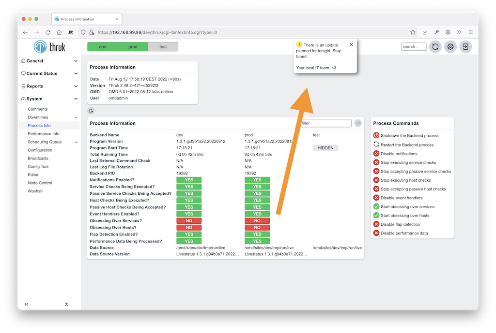
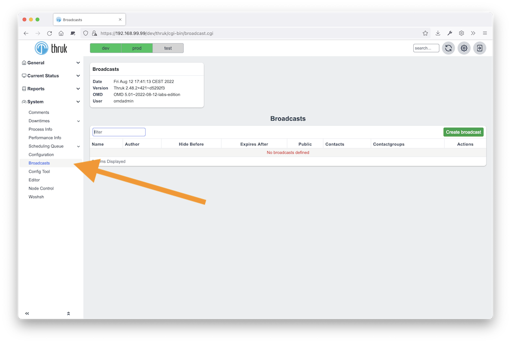

# Broadcast Announcements

<Badge type="tip" text="New in Thruk 2.14" />
Broadcasts show news and other relevant information to Thruk users.
They appear on all pages except the panorama dashboard.
Each broadcast appears on every visit until it expires or the user clicks the dismiss link.

[](advanced/broadcast.png)
<br style="clear: both;">

### Create new Broadcast

Administrators with the configuration_information and systems_command roles can use the broadcast editor.
Open it from the preferences menu at the top right.

[](advanced/broadcast_editor.png)
<br style="clear: both;">

#### HTML

Broadcasts may contain html, css and javascript code, see example below.

#### Macros

<Badge type="tip" text="New in Thruk 2.22" />
Use these text macros in templates:

- &#123;&#123;contact&#125;&#125;: will be replaced with the author name
- &#123;&#123;contactemail&#125;&#125;: will be replaced with the authors email (if availabe)
- &#123;&#123;date&#125;&#125;: contains the date from saving the broadcast
- &#123;&#123;theme&#125;&#125;: contains the users selected theme. Can be used for images.

#### Frontmatter

<Badge type="tip" text="New in Thruk 2.22" />
To define your own variables, add front matter like this:

```

---
variable: text content
another: more text
---
```

Use these variables in the broadcast message like normal macros:

```

here comes the {{variable}}
```

#### Example

Full example with html and macros:

```


<b>Upcoming maintenance change</b>:<br>

<pre style="font-family: inherit;">
Thruk will be updated <font color="red">next wednesday</font>
to the latest release. We are expecting
no downtime but lots of new features.
</pre>

{{contact}} - <a href="mailto:{{contactemail}}">{{contactemail}}</a>
<span style="float: right">(<i>Last Update: {{date}}</i>)</span>

<style>
/* set panorama background color */
DIV.popup-msg .msg {
  background: rgba(240,240,240,0.85);
}
/* background color on other pages */
TABLE.js-broadcast-panel {
  background-color: rgba(255,255,255,0.85);
}
</style>
```

### Create new Broadcast manually

You can create broadcasts manually in `var/broadcasts`.
Put each broadcast in a separate file with the `.json` extension.
The folder is usually `/var/lib/thruk/broadcast` or, for OMD, `~/var/thruk/broadcast`.
You may need to create the folder first.

A full example might look like this:

**/var/lib/thruk/broadcast/2017-02-09-example.json**

```
{
  "text":         "<b>Announcement:</b> The last update introduced broadcasts, read more at <a href='https://thruk.org' target='_blank'>thruk.org</a>.",
  "contacts":      [],
  "contactgroups": [],
  "hide_before":  "2017-02-01 00:00:00",
  "expires":      "2018-01-01 00:00:00"
}
```

::: tip filenames
Thruk sorts broadcasts by filename. Use the pattern YYYY-MM-DD-title, for example: 2017-02-08-release-announcement.json
:::

A broadcast can have these attributes:

```
 ** `text`           This is the raw text of your news. It may contain html and css to customize look and feel.
 ** `contacts`       A list of contacts which should receive the broadcast.
 ** `contactgroups`  A list of contactgroups which should receive the broadcast.
 ** `hide_before`    If set, the broadcast will not be shown before this date. Format is: YYYY-MM-DD HH:MM:SS.
 ** `expires`        If set, the broadcast will not be shown after this date. Format is: YYYY-MM-DD HH:MM:SS.
 ** `loginpage`      If set, the broadcast will be displayed for unauthenticated users on the login page as well
 ** `annotation`     Small annotation icon, choose between 'info' or 'warning'
```

All attributes except the text itself are optional.

### Authorization

Unless you specify `contacts` or `contactgroups`, broadcasts are public for all contacts and users.
To exclude a group or contact, prefix its name with `!`.

### Examples

This example contains only a text message. It appears for all users.

```
{
  "text": "<b>Announcement:</b> this is a simple broadcased news."
}
```

The next broadcast is limited to two contactgroups.

```
{
  "text":          "<b>Announcement:</b> this is a broadcased for admins and operators only.",
  "contactgroups": ["Admins", "Operators"]
}
```

This broadcast is for everyone except a Dashboard group.

```
{
  "text":          "<b>Announcement:</b> this is a broadcased for everyone except dashboards.",
  "contactgroups": ["!Dashboard"]
}
```
