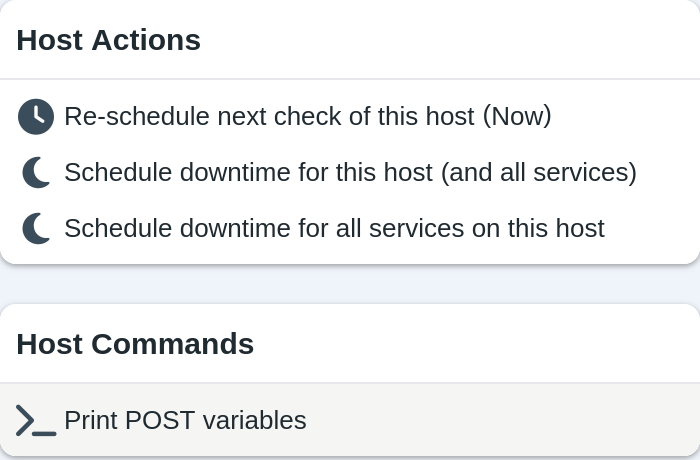
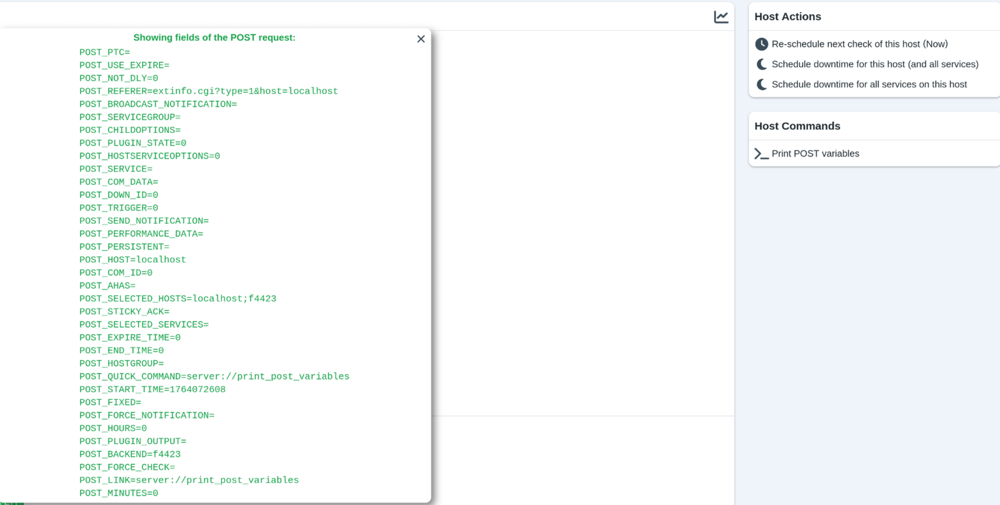

# Custom Host Actions

<Badge type="tip" text="New in Thruk 3.26" />

To add custom actions to the Host Actions menu on host detail pages,
create `user_host_commands.tt` in your user template path.



The template file has two parts:

1. The first part adds host actions that send GET requests. These follow the existing host command format. Users click a link to run them.

2. The second part adds host actions that send POST requests. When users click the link, JavaScript submits a form with hidden fields.

The quick action's script receives the form fields as POST variables.

All variables are available as environment variables prefixed with `POST_`.

To print these variables to stdout for testing, use `print_post_variables.sh`
in the Thruk script folder. The template includes an example that calls this script.

Two special variables contain the selected objects:

- `POST_SELECTED_SERVICES`: A list of all selected services.
- `POST_SELECTED_HOSTS`: A list of all selected hosts.

The format of the selected services is:

```
HOST;SERVICE;BACKEND~~HOST;SERVICE;BACKEND~~...
```

The format of the selected hosts is:

```
HOST;;BACKEND~~HOST;;BACKEND~~...
```

When a host action runs from a host overview page with a single script,
selected_hosts contains only that host in the format above.
The selected_services variable is empty in that case.

## Examples

### Add a custom quick action

This custom host action prints all POST variables to stdout.



If the user template path is not set, add it to `thruk_local.conf`:

**thruk_local.conf**

```
  user_template_path = ./my_templates
```

Create `user_host_commands.tt` in that directory with this content:

**my_templates/user_host_commands.tt**

```

[%# This template is for custom host commands that the user specifies. #%]
[%# It will be put directly after the hardcoded host commands. It is evaluated all at once, does not need to be split into multiple blocks. #%]

[%# ========================= Templated GET Host Actions ========================= #%]

[%# The command pane already includes commands. #%]
[%# Take note to adapt to their style for custom actions. #%]

[%# Example GET command taken from template. #%]
<div>
    [% IF host.accept_passive_checks %]
        <a class="js-modal-command-link" href="cmd.cgi?cmd_typ=93&amp;host=[% host.name | uri %]&amp;backend=[% host.peer_key %]">
            <i class="fa-solid fa-xmark round small red"></i>Stop accepting passive checks for this host
        </a>
    [% END %]
</div>

[%# ========================= Templated POST Host Actions ========================= #%]

[%# You can insert a html form for submitting POST requests. #%]
[%# These forms can be sent with the link via JS so they look like the other links. #%]

[%# Example POST command. #%]
<div>
    <form id="host_print_post_variables_form" action="cmd.cgi" method="POST" onsubmit="">
        [%# These values here can be taken from the host object, which is in the scope where this template is included. #%]
        <input type='hidden' name='host' value="[% host.name | uri %]">
        <input type='hidden' name='backend' value="[% host.peer_key | html %]">

        [%# In the quick command menu, one can select multiple hosts. This builds a string called selected hosts. #%]
        [%# An example of this string looks like this: localhost;f4423~~testhost;f4424 #%]
        [%# In the host commands pane, we only have one host, so we do not need to join multiple hosts with '~~' #%]
        [%# We are also adding this field so that the scripts for the quick commands can be used as a reference for further processing. #%]
        <input type='hidden' name='selected_hosts' value="[% host.name | html %];[% host.peer_key | html %]">
        [%# Also define the other variable. In the host overview, there is no service to select. #%]
        <input type='hidden' name='selected_services' value="">

        [%# These values are are required for sending post requests. #%]
        <input type='hidden' name='referer' value="[% short_uri(c, {referer => 'undef'}) %]">
        <input type="hidden" name="CSRFtoken" value="[% get_user_token(c) %]">

        [%# This is the command name that is defined in the Thruk configuration for this custom command #%]
        [%# It should be defined under action_menu_actions section in one of the thruk configuration files #%]
        [%# This example just calls the custom command 'print_post_variables'. #%]
        <input type='hidden' name='quick_command' value="server://print_post_variables">
    </form>
    <a class="js-modal-command-link" href="#" onclick="document.getElementById('host_print_post_variables_form').submit(); return false;">
        <i class="fa-solid fa-terminal"></i>Print POST variables
    </a>
</div>
```

Add an entry for the script that runs when someone uses the quick action.

**thruk_local.conf**

```
<action_menu_actions>
  print_post_variables = ./share/thruk/script/print_post_variables.sh
</action_menu_actions>
```

The `print_post_variables.sh` script could look like this:

**print_post_variables.sh**

```bash
#!/bin/bash

# This script is intended to print details of a post request to the CGI.
# It should be invoked with a POST request to the CGI.
# This should be added as a custom service/host action to the Thruk.
# See the documentation for custom service/host actions more information.

echo "Showing fields of the POST request:"
env | grep 'POST_'
```
