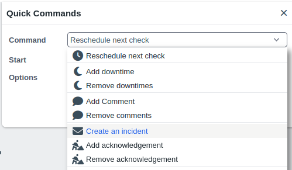

# Custom Quick Actions

<Badge type="tip" text="New in Thruk 3.24" />

To add custom quick actions on host and service detail pages,
create `user_quick_commands.tt` in your user template path.



The template file can contain two blocks:

- The `init` block adds quick actions to the existing list.
- The `form` block adds fields to the quick action form.

The quick action's script receives the form fields as POST variables.
All variables are available as environment variables prefixed with `POST_`.

There are two special variables containing the selected objects:

- `POST_SELECTED_SERVICES`: A list of all selected services.
- `POST_SELECTED_HOSTS`: A list of all selected hosts.

The format of the selected services is:

```
HOST;SERVICE;BACKEND~~HOST;SERVICE;BACKEND~~...
```

The format of the selected hosts is:

```
HOST;;BACKEND~~HOST;;BACKEND~~...
```

## Examples

### Add a custom quick action

This custom quick action opens a form to create an incident in an external system.
The form contains a comment field, a team selection and an option to create one ticket
for all selected objects.

If the user template path is not set, add it to `thruk_local.conf`:

**thruk_local.conf**

```
  user_template_path = ./my_templates
```

Create `user_quick_commands.tt` in that directory with this content:

**my_templates/user_quick_commands.tt**

```

[%# the init block may adjust the list of 'quick_commands' #%]
[% IF block == "init" %]
  [%
    CALL quick_commands.push({
        val     => "server://testaction",
        icon    => "fa-solid fa-envelope",
        label   => "Create an incident",
        hide    => 0,
        cmd_chk => [],
        cls     => "",
        form    => [ 'row_comment', 'row_cust_teams', 'row_cust_options' ],
      });
  %]
[% END %]

[%# the form block can add required form blocks #%]
[% IF block == "form" %]
  <tr id="row_cust_teams" class="js-quick-command-form-options">
    <th class="align-top">Team</th>
    <td>
      <select name="team">
        <option value="team1">Team1</option>
        <option value="team2">Team2</option>
        <option value="team3">Team3</option>
      </select>
    </td>
  </tr>
  <tr id="row_cust_options" class="js-quick-command-form-options">
    <th class="align-top">Options</th>
    <td>
      <input type="checkbox" id="single"> <label for="single">One ticket for all</label>
    </td>
  </tr>
[% END %]
```

Add an entry for the script that runs when someone uses the quick action.

**thruk_local.conf**

```
  <action_menu_actions>
    testaction   = ./testaction.sh
  </action_menu_actions>
```

The `testaction.sh` script could look like this:

**testaction.sh**

```bash
#!/bin/bash

# acknowledge all selected services.

LOG=/tmp/actionmenu.log
exec >$LOG 2>&1
echo "[$(date)]" >> $LOG

IFS='~~' read -ra SERVICES <<< "$POST_SELECTED_SERVICES"
for SVC in "${SERVICES[@]}"; do
    if [ "x$SVC" = "x" ]; then
        continue;
    fi
    IFS=';' read -r HOST SERVICE BACKEND <<< "$SVC"
    thruk -A $REMOTE_USER r \
        -b "$BACKEND" \
        -d "comment_data=$POST_COM_DATA" \
        -d "cmd=acknowledge_svc_problem" \
        -d "host=$HOST" \
        -d "service=$SERVICE" \
        /cmd
done

exit 0
```
