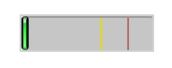

# Thruk Dashboard

The Thruk Dashboard, also called the panorama plugin, lets you place icons
and widgets on a canvas to create dashboards.

A demo is available at <a href="https://demo.thruk.org/demo/thruk/cgi-bin/panorama.cgi" target="_blank">demo.thruk.org</a>.
<br style="clear: both;"><br>

::: tip
Drop me an e-mail if you have nice screenshots, useful shapes or
free iconsets.
:::

[](dashboard/dashboard.png)
<br style="clear: both;">

## Creating New dashboards

To create a dashboard, click `new tab` next to the open dashboards.

### Dashboards and GeoMaps

A normal dashboard is an empty canvas for elements.
You can add a background image, then scale and move it.

GeoMaps use an openstreetmap background for icons and widgets.
Use the `map lock button` in the top left corner to lock the map.
While locked, it works like a normal dashboard. Unlock it to drag and zoom the map.
The `world` button returns to the default view.
To change that view, select `Set Map Center` from the context menu.

When you place an icon, GeoMaps converts its x / y position to latitude and longitude.
Icons keep their geographic positions as you navigate the map.

### Dashboard Permissions

Thruk stores each dashboard as a separate map owned by a user.
When you create a dashboard, only you can see it by default.
Administrators can see and edit all dashboards.
These are contacts with the configuration information and system commands roles.

Through release v1.86, making a dashboard public gave everyone read-only access.
From v1.88, you can assign read-only and read-write permissions to specific contactgroups.

To open dashboard settings, double-click the title or choose settings from the context menu.
Change access in the permissions tab.

[](dashboard/permissions.png)
<br style="clear: both;">

### Export / Import

Use the dashboard settings window to export or import dashboards.

## Icons, Widgets and Labels

### Widgets

Widgets are framed panels that contain grids, graphs and other data.

Some widget examples are:

- Servicetotals Pie Chart
- Mine Map
- PNP Graphs
- Logfiles
- Business Process Graphs
- Embedd content from other sites with the generic url panlet

### Icons

Icons represent the state of a single host, service or filtered query and are
usually placed on a map or background image.

The state can be represented in various types:

- image icon
- speedometer
- pie chart
- traffic lights
- arrows and shapes
- watermarks and lines

### Labels

Each icon and widget can have a static or dynamic label.
To change icon settings, double-click the icon or right-click it to open the context menu.

[](dashboard/contextmenu.png)
[](dashboard/dynlabel.png)
[](dashboard/dynlabel2.png)
<br style="clear: both;">

Source:

```
{
  "general": {
    "host": "",
    "service": ""
  },
  "layout": {
    "x": "100",
    "y": "100"
  },
  "appearance": {
    "type": "speedometer",
    "speedowidth": 180,
    "speedosteps": "10",
    "speedomargin": 5,
    "speedocolor_ok": "#199C0F",
    "speedocolor_warning": "#CDCD0A",
    "speedocolor_critical": "#CA1414",
    "speedocolor_unknown": "#CC740F",
    "speedocolor_bg": "#DDDDDD",
    "speedofactor": "1e3",
    "speedogradient": "-0.15",
    "speedosource": "perfdata:users"
  },
  "label": {
    "labeltext": "{{perfdata.users.val}}",
    "fontcolor": "#000000",
    "fontsize": 20,
    "position": "below",
    "offsetx": -56,
    "orientation": "horizontal",
    "bgcolor": "#C0C0C0",
    "bordercolor": "#000000",
    "bordersize": 1
  }
}
```

To use an example, add any icon widget.
Paste the example's source into the 'Source' tab, then click 'Apply'.

The 'Wizard' button to the right of the label field helps you create labels.
Click an example to insert it into the text area.

## Editing Dashboards

### Cloning Widgets and Icons

#### Icons

To clone a configured icon, right-click it and select `Clone`.
Then click where you want to place the clone.
Use `Copy` and `Paste` in the context menu to copy icons between dashboards.

#### Widgets

From release v1.88, you can also clone widgets.
Click the clone button at the top right of the panel header.
Then choose a location for the cloned widget.

### Restore Points

Since release v1.88, you can create up to 5 manual restore points.
To undo changes, select a restore point from the context menu.

Thruk also creates automatic restore points every 10 minutes and keeps up to 5.

## Icon Widget Appereance Types

### Icon

Icons are the basic appearance type for hosts, services, hostgroups and servicegroups.
Host and service icons change according to their state.

[](dashboard/icon.png)
[](dashboard/qtip.png)
<br style="clear: both;">

Hover over an icon to see host/service details.
For groups and filters, the popup shows a summary of the matching hosts/services.

Choose a global iconset in the dashboard settings.
You can override it for individual icons.

### Shape

Shapes are SVG images. They usually contain one closed path filled with the
state's color. Shapes can show host/service states or summary states for groups
and filtered sets.

If the icon source is a single host or service, the shape's gradient color can
use its performance data.

[](dashboard/shape.png)
<br style="clear: both;">

To create a shape, draw a path in an SVG editor such as inkscape.
Save the SVG file. Open it in a text editor and find the path:

For example:

```
  <path
     style="fill:#000000;stroke:#000000;stroke-width:1px;stroke-linecap:butt;stroke-linejoin:miter;stroke-opacity:1"
     d="m 130,252.36218 200,0 0,-70 105,105 -105,105 0,-70 -200,0"
     id="path2997"
     inkscape:connector-curvature="0"
     sodipodi:nodetypes="ccccccc" />
```

Then copy an existing shape and replace the path with the value of the 'd' attribute.

Source:

```
{
  "general": {
    "host": "",
    "service": ""
  },
  "layout": {
    "x": "100",
    "y": "100"
  },
  "appearance": {
    "type": "shape",
    "shapename": "arrow",
    "shapewidth": 50,
    "shapelocked": "1",
    "shapecolor_ok": "#199C0F",
    "shapecolor_warning": "#CDCD0A",
    "shapecolor_critical": "#CA1414",
    "shapecolor_unknown": "#CC740F",
    "shapegradient": "0.1",
    "shapesource": "fixed"
  }
}
```

### Pie Chart

Pie charts show group and filtered states.

[](dashboard/pie.png)
<br style="clear: both;">

Source:

```
{
  "general": {
    "hostgroup": "",
    "incl_hst": "on"
  },
  "layout": {
    "x": "100",
    "y": "100"
  },
  "appearance": {
    "type": "pie",
    "piewidth": 120,
    "pielocked": "1",
    "piedonut": 0,
    "piecolor_ok": "#199C0F",
    "piecolor_warning": "#CDCD0A",
    "piecolor_critical": "#CA1414",
    "piecolor_unknown": "#CC740F",
    "piecolor_up": "#199C0F",
    "piecolor_down": "#CA1414",
    "piecolor_unreachable": "#CA1414",
    "piegradient": "-0.15"
  }
}
```

### Speedometer

Speedometers show performance data for a single host or service.
Use a label to show the numeric value alongside the speedometer.

[](dashboard/dynlabel2.png)
<br style="clear: both;">

Source:

```
{
  "general": {
    "host": "",
    "service": ""
  },
  "layout": {
    "x": "100",
    "y": "100"
  },
  "appearance": {
    "type": "speedometer",
    "speedowidth": 180,
    "speedosteps": "10",
    "speedomargin": 5,
    "speedocolor_ok": "#199C0F",
    "speedocolor_warning": "#CDCD0A",
    "speedocolor_critical": "#CA1414",
    "speedocolor_unknown": "#CC740F",
    "speedocolor_bg": "#DDDDDD",
    "speedogradient": "-0.15",
    "speedosource": "perfdata:users"
  }
}
```

### Performance Bar

A Performance Bar is the exact same performance bar as on the normal Thruk status pages.

[](dashboard/performancebar.png)
<br style="clear: both;">

Source:

```
{
  "general": {
    "host": "",
    "service": "PING"
  },
  "layout": {
    "x": "100",
    "y": "100",
    "zindex": "0"
  },
  "appearance": {
    "type": "perfbar"
  }
}
```

### Trend Icon

The Trend Icon calculates a trend from collected performance data.
It displays an arrow or another icon when the current delta value reaches a threshold.
It can fetch initial performance data from pnp4nagios.
Then it collects performance data on each status refresh.

[](dashboard/trendicon.png)
<br style="clear: both;">

Source:

```
{
  "general": {
    "host": "",
    "service": "PING"
  },
  "layout": {
    "x": "100",
    "y": "100",
    "zindex": "0"
  },
  "appearance": {
    "type": "trend",
    "trendiconset": "default_64",
    "trendsource": "perfdata:rta",
    "trendfunctionin": "average",
    "trendrangein": "5m",
    "trendfunctionvs": "average",
    "trendrangevs": "12h",
    "trendoffsetvs": "0m",
    "trendfixedvs": "1",
    "trendverygood": -10,
    "trendgood": -5,
    "trendverybad": 10,
    "trendbad": 5
  }
}
```

### Text Label

Place static Text Labels wherever you need additional text.

[](dashboard/text.png) <br style="clear: both;">

Source:

```
{
  "layout": {
    "x": "100",
    "y": "100",
    "rotation": 45
  },
  "label": {
    "labeltext": "Text Label",
    "fontcolor": "#000000",
    "fontfamily": "",
    "fontsize": 14,
    "fontitalic": "",
    "fontbold": "",
    "position": "below",
    "offsetx": 0,
    "offsety": 0,
    "orientation": "horizontal",
    "bgcolor": "",
    "bordercolor": "",
    "bordersize": 1
  }
}
```

### Static Image

Use static images to add images to a map without changing its background image.

You can get tons of icons on <a
href="http://openiconlibrary.sourceforge.net/webpage_icons.html"
target="_blank">openiconlibrary</a>.
Just download and unzip into your images folder (Usually something like /etc/thruk/usercontent/images/).
<br><br><br style="clear: both;">

[](dashboard/image.png)
<br style="clear: both;">

Source:

```
{
  "general": {
    "src": "../usercontent/images/fear_and_loathing.jpg"
  },
  "layout": {
    "x": "100",
    "y": "100"
  }
}
```

## Scripted Dashboards

You can also use [Scripted Dashboards](dashboard_scripted.html).
