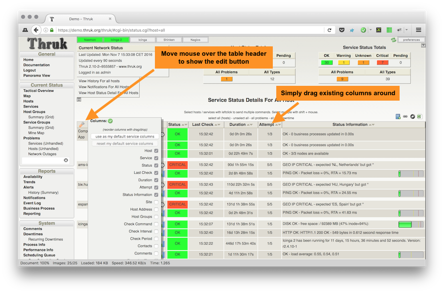

# Dynamic Views

<Badge type="tip" text="New in Thruk 2.14" />
Dynamic Views let you change the columns and layout of host and service lists.

There are 3 ways to change the columns:

- On the fly with the edit button (resets when you leave the page)
- By setting a default view for your user in the edit menu above
- By setting a default view in the main config file (thruk_local.conf)



## Change columns on the fly

To change columns temporarily, open the edit menu shown above.
When you leave the page, the columns return to their defaults.

## Set default view for own user

To save the column layout for your account, click "use as my default ... columns"
in the edit menu. Thruk uses the saved layout whenever you open a host or
service list. You can save separate layouts for host lists and service lists.

## Set default view from main config file

Use `default_host_columns` and `default_service_columns` to set default views
for your users. Each option takes a comma-separated list that defines which
columns appear and their order.

ex.:

```
default_host_columns = name,state,last_check,duration,plugin_output
```

See [available columns](#_available-columns) for supported column names.

This example sets a reduced view for the contact_group managers and adds a comments column.

ex.:

```
<Group managers>
  default_host_columns = name,state,comments
  default_service_columns = host_name,description,state,duration,comments
</Group>
```

## Available columns {#_available-columns}

Available columns for hosts are:

- name
- state
- last_check
- duration
- plugin_output
- peer_name
- current_attempt
- address
- check_command
- check_interval
- check_period
- contacts
- comments
- event_handler
- execution_time
- groups
- latency
- next_check
- notification_period
- percent_state_change

Available columns for services are:

- host_name
- description
- state
- last_check
- duration
- current_attempt
- plugin_output
- peer_name
- host_address
- host_groups
- check_command
- check_interval
- check_period
- contacts
- comments
- event_handler
- execution_time
- groups
- latency
- next_check
- notification_period
- percent_state_change

Available columns for overview are:

- name
- alias
- address
- state
- services
- actions

## Adding custom variables

You can display custom variables in separate columns. Thruk automatically adds
all variables listed in `show_custom_vars` to the available columns.

Add each custom variable explicitly to `show_custom_vars` or `expose_custom_vars`.
The wildcard `*` is not enough.

ex.:

```
default_host_columns = name,state,cust_LOCATION:Location
show_custom_vars = _LOCATION
```

## Rename Columns

To rename a column header, double-click its text or change the configuration.
In the configuration, add a colon followed by the new name.

ex.:

```
default_host_columns = name,state:Host Status,comments
```
