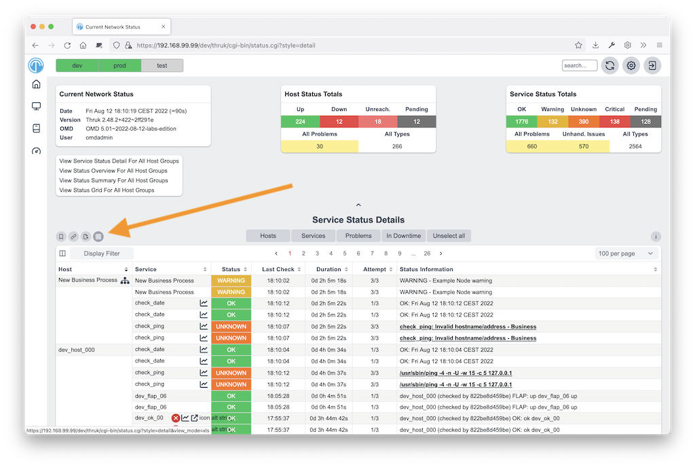
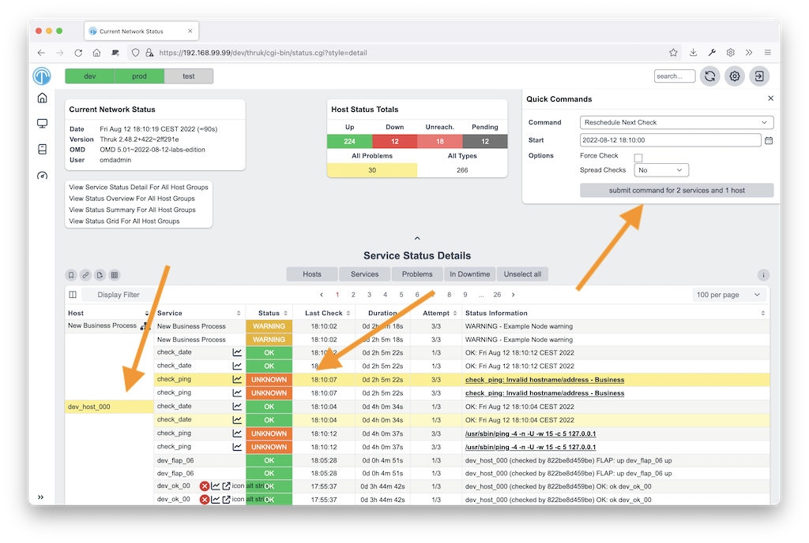
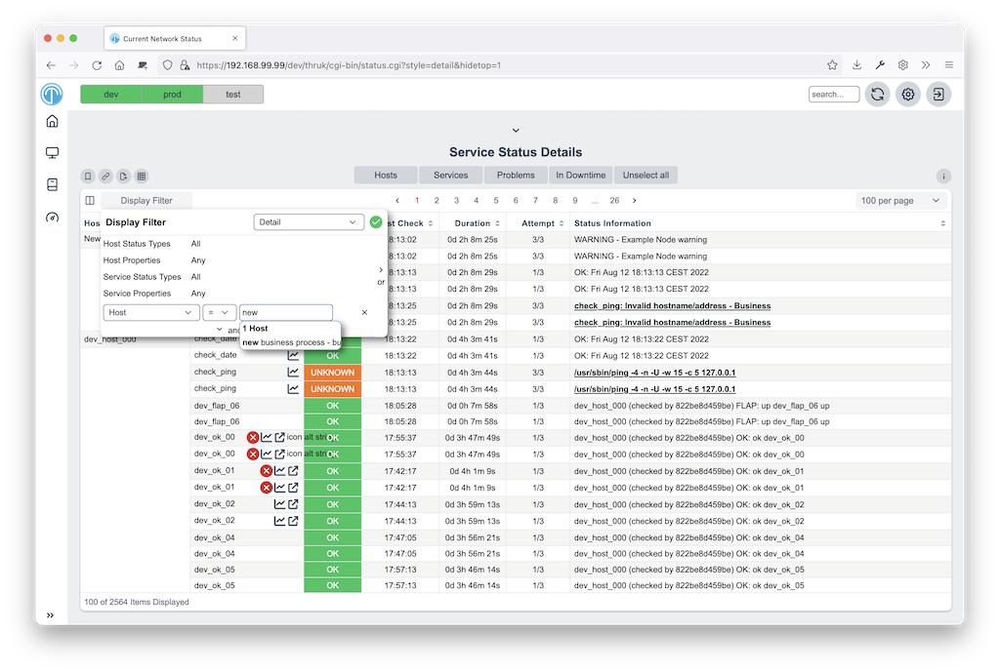
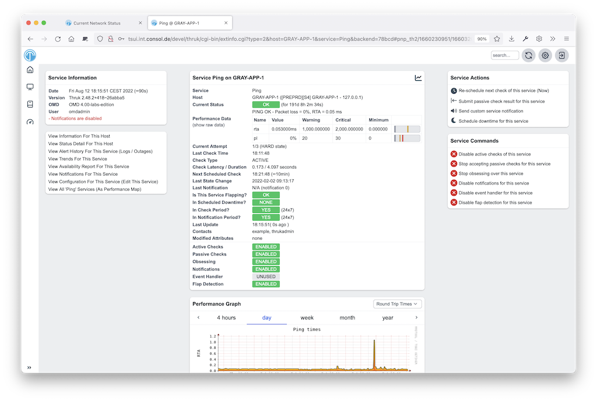
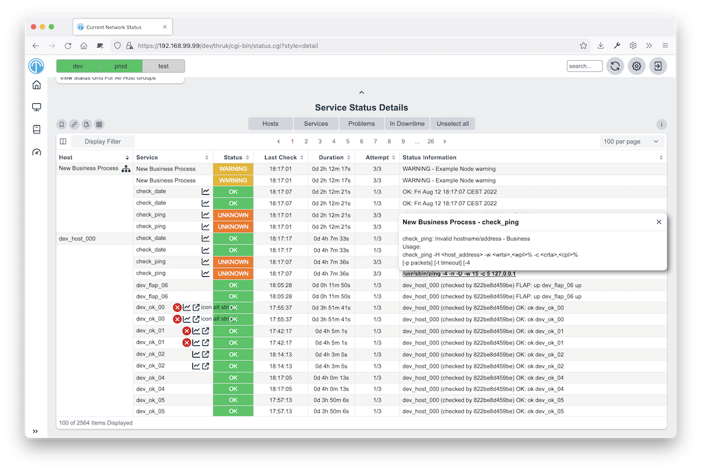

# Introduction

Thruk is a monitoring web interface for multiple backends. It supports
Naemon, Nagios, Icinga and Shinken through the Livestatus API.
It is designed as a drop-in replacement and covers almost 100% of the
original features. It adds support for large installations and improves usability.

Main features

- Multiple backends
- Faster, no need to parse status.dat for every request
- Less CPU usage
- Displays live data, no delay between core and GUI
- Independent of the monitoring core, can be installed on a remote host
- Can be clustered across multiple hosts
- Change status.cgi filter inline
- Extended logfile search
- Better logging, uses log4perl (who submitted which command?)
- Valid HTML code
- No frames (can be reenabled for better addon integration)
- Easy to extend with plugins
- Pagination
- Multiple themes included
- Excel export for status and logfiles
- Adjustable side menu
- Fully expanded plugin command line for easy testing
- Save searches in personal bookmarks
- Config Tool included
- Mobile interface included
- SLA Reports in PDF format
- Recurring Downtimes
- Fully Featured Dashboard
- Business Process Addon

## How it works

Thruk uses Perl and the
[Plack Framework](http://plackperl.org). It connects to monitoring backends through the
[Monitoring::Livestatus](http://search.cpan.org/dist/Monitoring-Livestatus)
Perl module. Thruk runs as a fastcgi process.
It calculates availability with
[Monitoring::Availability](http://search.cpan.org/dist/Monitoring-Availability).
The Apache webserver provides authentication, for example with
mod_auth_basic, mod_auth_ldap or mod_auth_mysql.

**Thruk architecture**

## Reasons to choose Thruk

## Multi Site Support

Thruk connects to as many cores as you want. You can combine
Naemon, Nagios, Icinga and Shinken instances in one view.
This gives you an overview of all installations across independent locations.
You can organize sites into groups.

## Flexible Dashboard

The Thruk Panorama plugin provides dashboards. Each user can create dashboards
and share them with colleagues. You can position elements, backgrounds and images
freely. To create a control center, link dashboards together and connect them to actions.

## SLA Reports

The 'reporting' plugin creates SLA reports in HTML and PDF format.
It can send the reports by email at regular intervals. You can also turn any
page in Thruk into a recurring email report.

## Business Process Integration

Use the Business Process addon to model your important applications and
business processes. It includes an online editor and notifications.

## Excel Export and Bookmarks

Use Bookmarks to save searches as personal menu items.
To change the menu for all users, edit menu_local.conf.

The Excel export creates real Excel files which can be sent by email or
used to extract hostnames and other information.

## Config Tool

Use the Config Tool to change monitoring objects and the Thruk configuration.
You can also manage user access through htpasswd files and change cgi.cfg settings.

## Sending Multiple Commands

Use the status pages to send multiple commands at once, including host and
service commands together. When you reschedule host and service checks,
Thruk waits for each check to finish and displays the result as soon as it returns.

## Easy Filtering

Change host and service filters without entering numbers in the URL.
Combine multiple filters to create views. Use the Ajax search to find
host and service names. Filters also support regular expressions.

## PNP4Nagios Graphs

When your action_url contains /pnp4nagios/, Thruk displays a performance history
graph for the host or service. Follow the graph's link to PNP4Nagios for details.

## Multiple Lines of Plugin Output

When a check returns multiple lines of plugin output, Thruk marks the output
in blue. Click it to see the complete output. This is especially useful for
check_multi checks.

Comments and downtimes also have popups with their data. You can see who
added a comment and when a downtime occurs without opening the host/service page.

## Mine Map

The Mine Map gives an overview of services across hosts. It is especially
useful when many hosts share the same services. Otherwise, use hostgroups or
servicegroups. The Mine Map also supports normal filtering.

