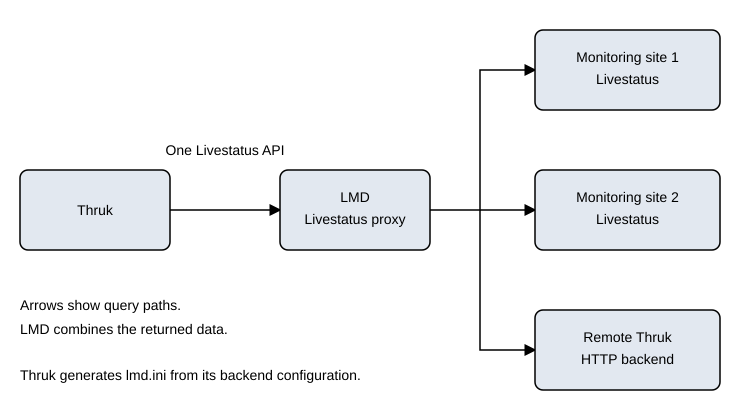

# LMD

<Badge type="tip" text="New in Thruk 2.12" />
[LMD](https://github.com/sni/lmd) is a transparent Livestatus proxy.
It fetches live data from remote sites/backends and combines it in one Livestatus API for Thruk.
When enabled, LMD manages all backend connections and combines their Livestatus data.



LMD provides these benefits:

- Faster access to many remote locations
- Better stability when connections are unreliable
- Fixes for some backend-specific Livestatus issues, for example in Icinga 2

::: tip icinga2
Use LMD with Icinga 2. Icinga2 is about to drop Livestatus support, so use Naemon if possible.
:::

Slides are available in German: [LMD - Livestatus Multitool Daemon](//www.slideshare.net/SvenNierlein/lmd-livestatus-multitool-daemon) by [Sven Nierlein](//www.slideshare.net/SvenNierlein).

## Installation

LMD uses Go and needs only one compiled binary to run.
OMD includes LMD. For other installations, build it from source.

### Using OMD-Labs

OMD-Labs is the easiest way to enable LMD. OMD includes LMD from version 2.20.
Follow the 3 setup steps here:

[OMD-Labs](https://labs.consol.de/omd/packages/lmd/)

### Using the Source

[Follow the LMD build instructions.](https://github.com/sni/lmd?tab=readme-ov-file#installation)

## Setup

Create a `lmd.conf` file in `/etc/thruk/thruk_local.d` with these settings:

```
use_lmd_core=1
lmd_core_bin=/opt/local/go/bin/lmd
```

You do not need to configure LMD separately. Thruk generates and updates
lmd.ini from its backend configuration.

Restart Apache and open Thruk in your browser.
After the first request, you should see an LMD process.

### Icinga2 Cluster Setup

To connect Thruk to an Icinga2 HA Cluster through LMD, add both cluster nodes
as 'peer' attributes in your `Component Thruk::Backend`.

```
<Component Thruk::Backend>
    <peer>
        name    = Icinga2 HA Cluster
        type    = livestatus
        <options>
            peer   = 172.16.0.1:6558
            peer   = 172.16.0.2:6558
        </options>
    </peer>
</Component>
```
