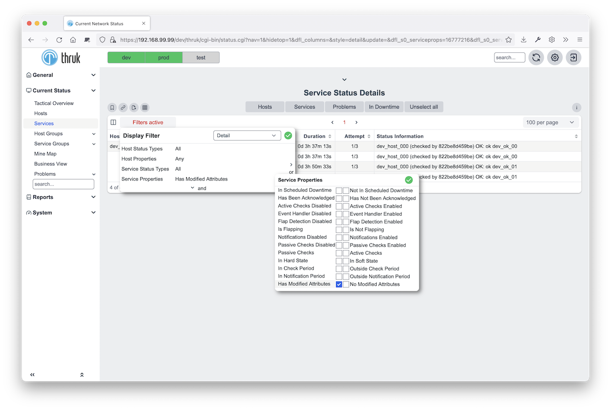
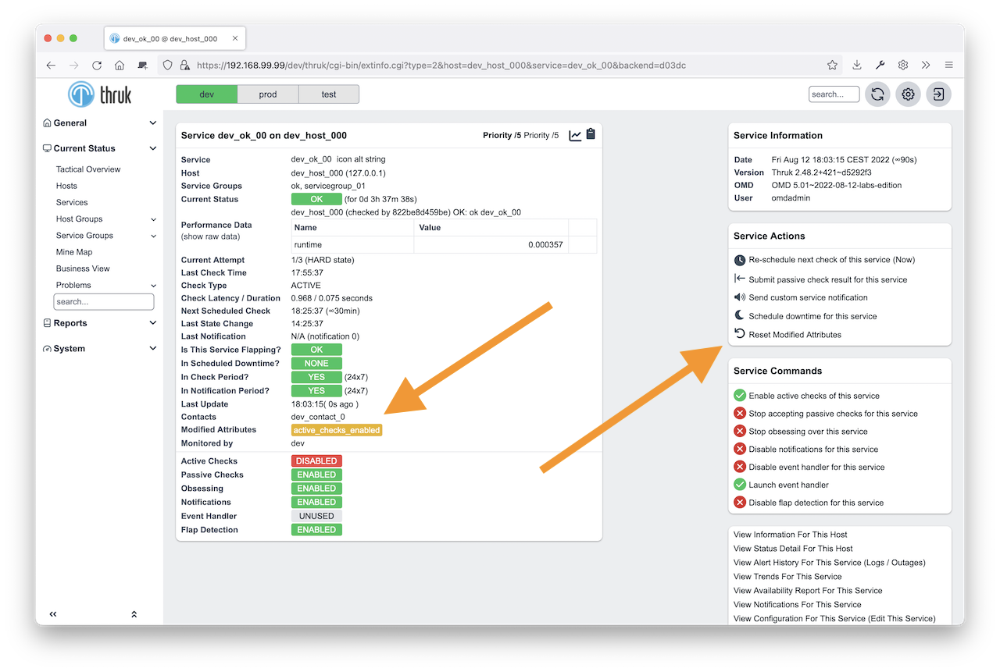

# Modified Attributes

When you change an attribute through the web GUI or command file, nagios saves
it in its retention file, depending on your retention settings.
Once nagios marks the attribute as changed, it ignores configuration file changes
for that attribute.

For example:

1. Notifications are enabled for a host.
2. A user disables notifications for this host and enables them again later.
3. Another user changes the host's notification setting in the configuration file, but nagios ignores the change.

Use the modified attributes filter to list hosts and services with changed attributes.
Reset the attributes with a quick command or a normal host/service command.

Naemon will then use the settings from the config file on the next reload.

 
