# Plugins

Plugins extend Thruk, and several plugins are included.
Plugins reside in 'plugins/plugins-available'.
To activate a plugin, create a symlink in 'plugins/plugins-enabled'.

For packaged installations, the plugins folder is directly in the Thruk folder.
For OMD, it is in $OMD_ROOT/etc/thruk/plugins.
After enabling or disabling plugins, restart Thruk / Apache.

Later Thruk versions include a plugin manager in the config tool.
You can manage plugins there.

Example of a plugins folder with some plugins enabled.

```text
 plugins
 ├── plugins-available
 │   ├── conf
 │   ├── minemap
 │   ├── reports2
 │   └── node-control
 └── plugins-enabled
     ├── conf             -> ../plugins-available/conf
     ├── minemap          -> ../plugins-available/minemap
     ├── reportss         -> ../plugins-available/reports2
     └── node-control     -> ../plugins-available/node-control
```

## Builtin Core Plugins

### Agents

```
 Author:      Sven Nierlein
 Description: Agent configuration for SNClient+ agents in Naemon.
 Download:    This plugin is builtin and shipped with Thruk
```

The agent plugin creates and manages the naemon configuration for [SNClient](https://github.com/ConSol-Monitoring/snclient) agents.

A detailed documention is available on the [agents plugin](plugins/agents/) page.

[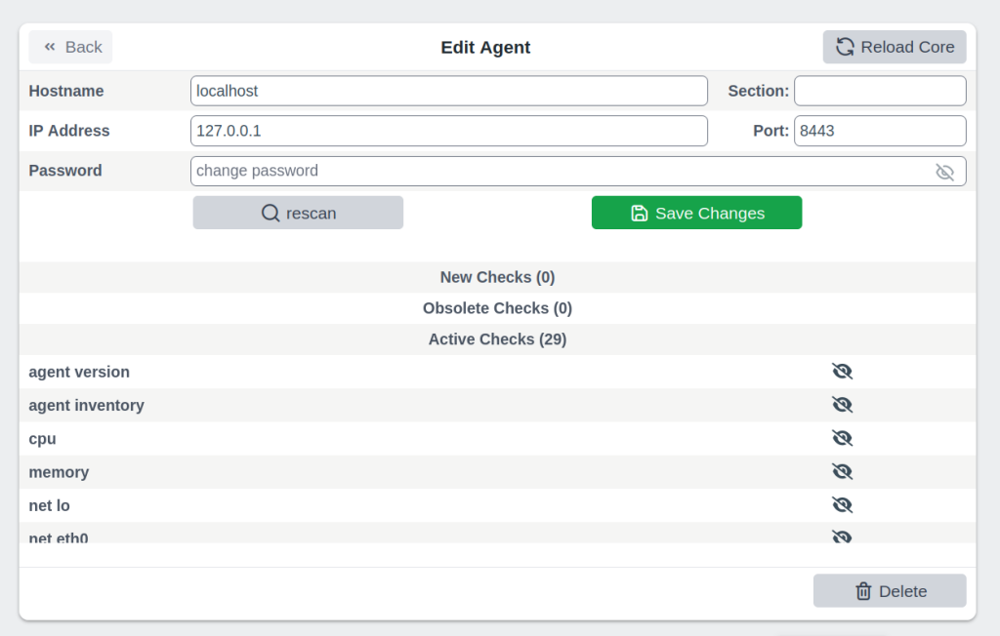](plugins/agents1.png)
<br style="clear: both;">

### Business Process

```
 Author:      Sven Nierlein
 Description: Calculates Business Processes
 Download:    This plugin is builtin and shipped with Thruk
```

The Business Process plugin creates, edits and calculates business processes.
You can display them as hosts and services and use them for notifications.

[](plugins/bp1.png)
<br style="clear: both;">

### Config Tool

```
 Author:      Sven Nierlein
 Description: Manage config files directly in Thruk
 Download:    This plugin is builtin and shipped with Thruk
```

The Config Tool plugin lets you edit cgi.cfg and thruk.cfg directly in Thruk.
Changes take effect immediately. You do not need to restart Thruk.

[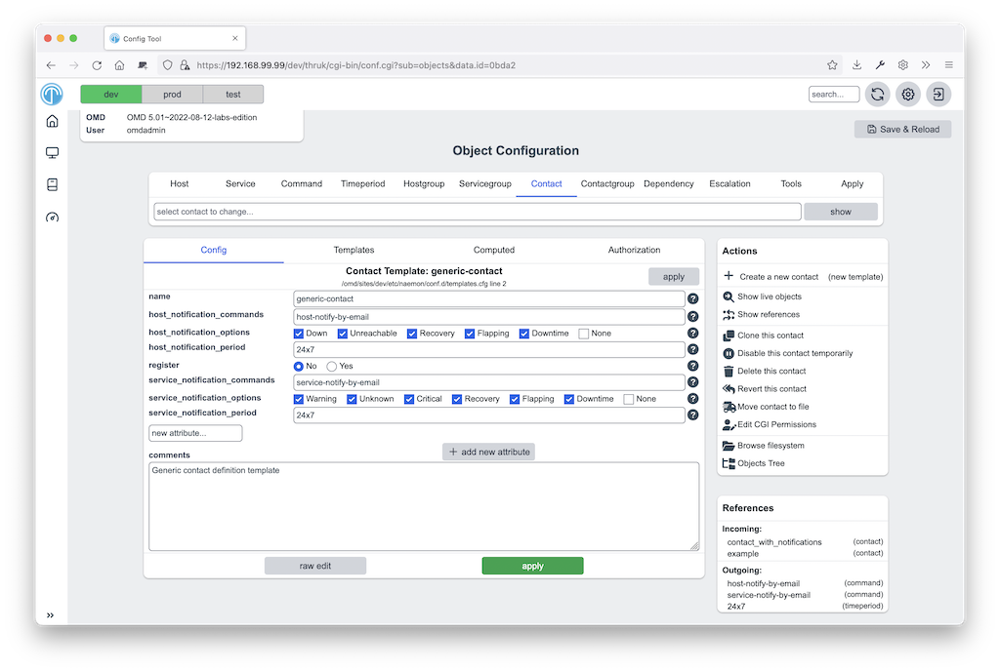](plugins/conf1.png)
[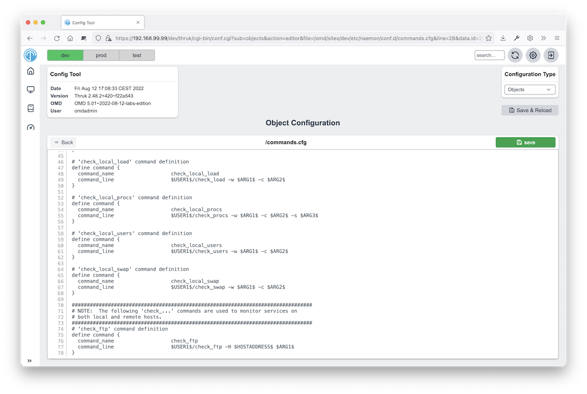](plugins/conf2.png)
[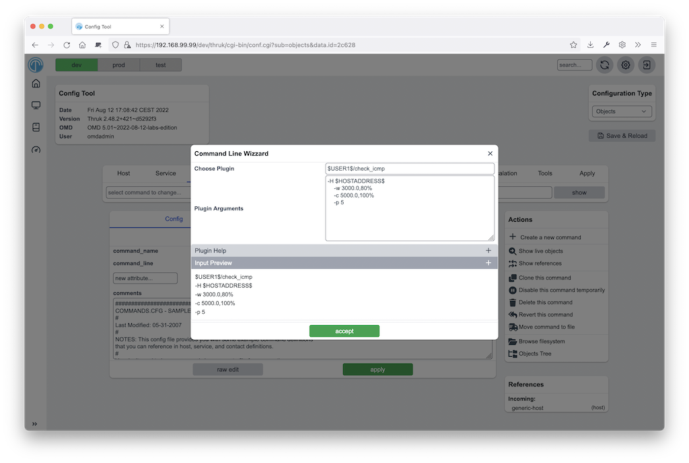](plugins/conf3.png)
<br style="clear: both;">

### Core Scheduling Graph

```
 Author:      Sven Nierlein
 Description: Visualize Core Scheduling
 Download:    This plugin is builtin and shipped with Thruk
```

The Core scheduling plugin shows active host and service checks on a timeline.
Its CLI command distributes all checks, or a subset, evenly to reduce load peaks.

This addon is shipped with Thruk since version 2.06 but not enabled by
default.

[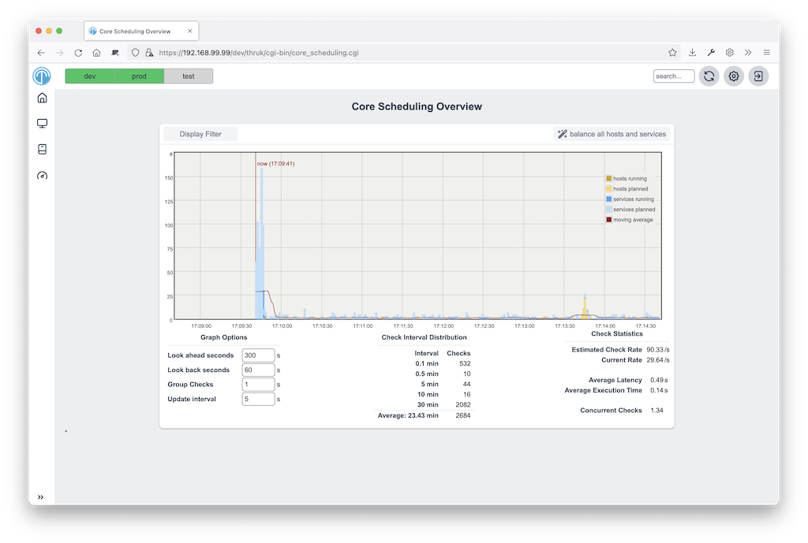](plugins/core_scheduling1.png)
<br style="clear: both;">

### Editor

```
 Author:      Sven Nierlein
 Description: Generic Text Editor
 Download:    This plugin is builtin and shipped with Thruk
```

The editor plugin edits all types of text files.
You can define custom actions for each file type, such as syntax checks.

A detailed documention is available on the [editor plugin](plugins/editor/) page.

[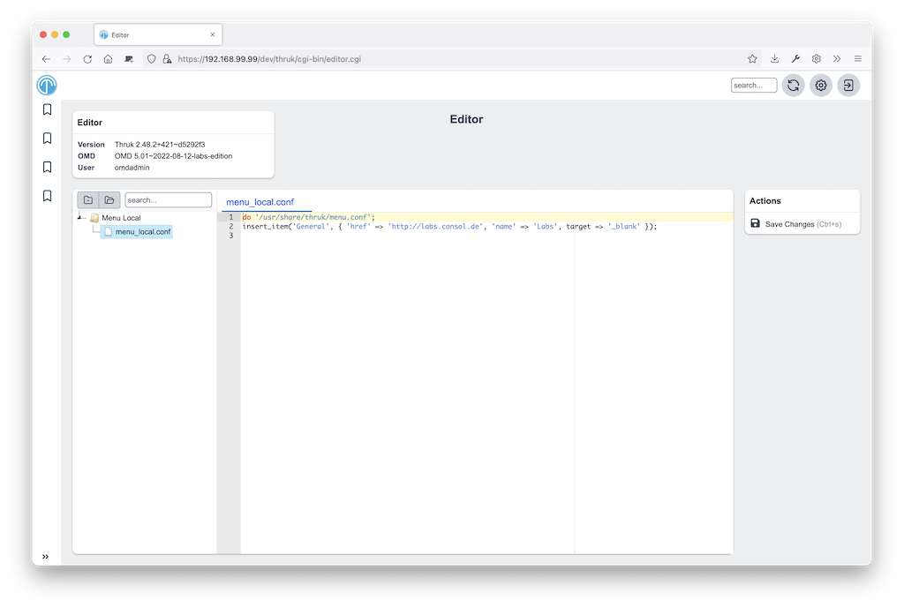](plugins/editor1.png)
<br style="clear: both;">

### Mine Map

```
 Author:      Sven Nierlein
 Description: The Mine Map gives a quick overview over similar
              services
 Download:    This plugin is builtin and shipped with Thruk
```

The Mine Map shows status in a grid of all selected host and service combinations.
Use normal filters to limit the services or show one hostgroup or servicegroup.
The Mine Map is especially useful when many hosts share the same services.

[](plugins/mine-map1.png)
<br style="clear: both;">

### Node-Control

```
 Author:      Sven Nierlein
 Description: Install OMD/OS Updates
 Download:    This plugin is builtin and shipped with Thruk
```

The node control plugin controls OMD nodes and installs or updates OMD versions.
It also installs OS updates and summarizes the node's main resources.

A detailed documention is available on the [node-control plugin](plugins/node-control/) page.

[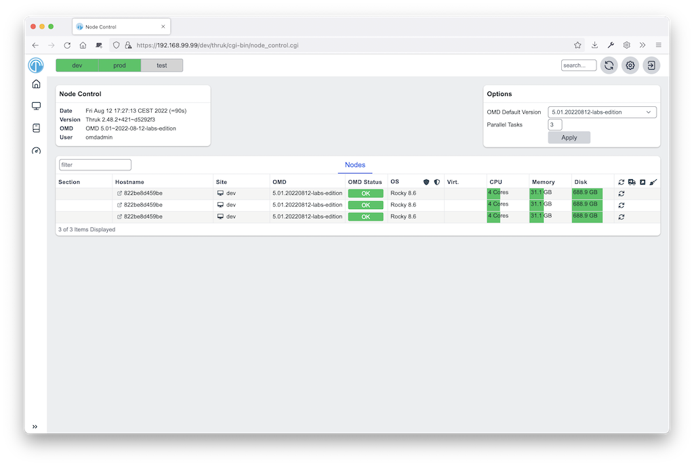](plugins/node-control1.png)
[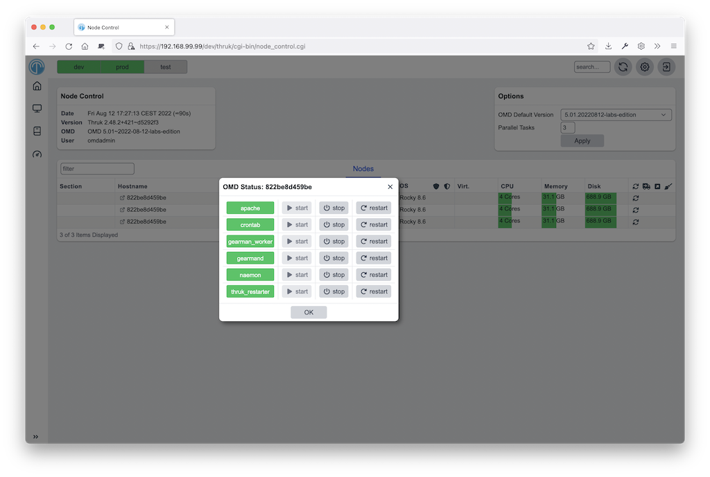](plugins/node-control2.png)
<br style="clear: both;">

### OMD

```
 Author:      Sven Nierlein
 Description: OMD Specific Addons
 Download:    This plugin is builtin and shipped with Thruk
```

The omd plugin saves `top` and `gearman_top` data every minute and keeps it
for the last week for debugging. Its usage graphs let you inspect individual data points.
For any point in the last week, you can fetch, sort and filter the complete top data.

A detailed documention is available on the [omd plugin](plugins/omd/) page.

[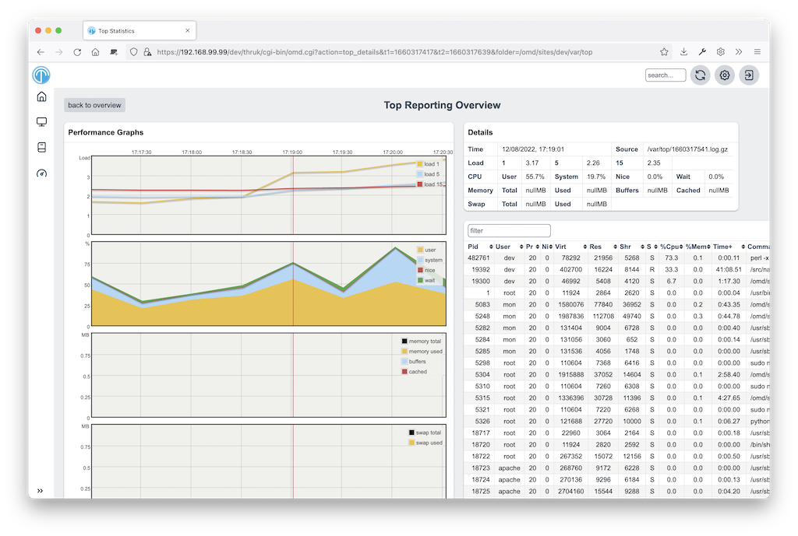](plugins/omd1.png)
<br style="clear: both;">

### Panorama

```
 Author:      Sven Nierlein
 Description: Panorama View Dashboard
 Download:    This plugin is builtin and shipped with Thruk
```

The 'Panorama' plugin lets you build custom dashboard views. It supports multiple panels
and sticky windows. [Read more](dashboard.html)

[](plugins/panorama1.png)
[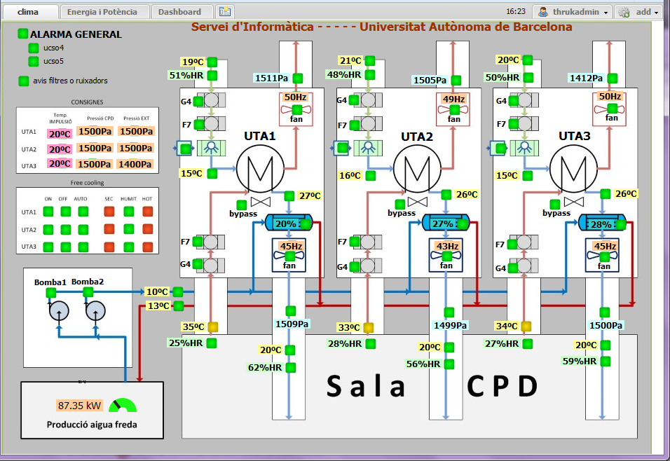](images/galleries/dashboard2.png)
<br style="clear: both;">

### Reports

```
 Author:      Sven Nierlein
 Description: SLA Reports
 Download:    This plugin is builtin and shipped with Thruk
```

SLA reports provide monthly reports about service level contracts.
Download reports or email them with the thruk command line tool.
[Read more](reporting.html)

[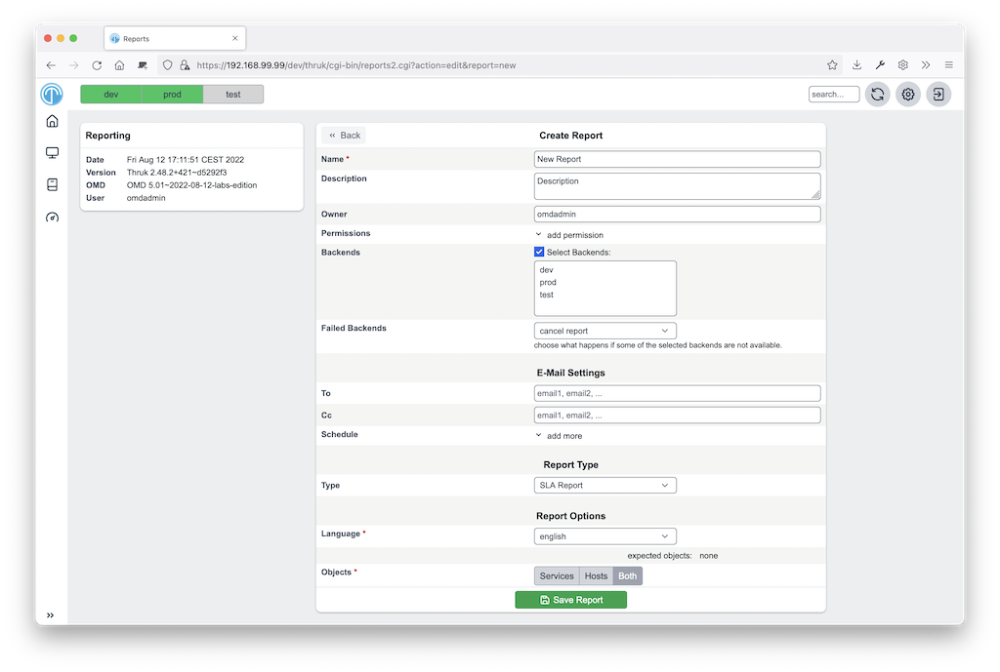](plugins/reports1.png)
[](plugins/reports2.png)
<br style="clear: both;">

### Shinken Features

```
 Author:      Jean Gabes, Sven Nierlein
 Description: Contains Shinken specific addons like business view and
              impacts view.
 Download:    This plugin is builtin and shipped with Thruk
```

This plugin contains all Shinken-specific addons for Thruk.
Most features require that only Shinken backends are active.
The business process view shows processes defined in Shinken.
The problems view lists root problems, which no other problem caused, in priority order.

[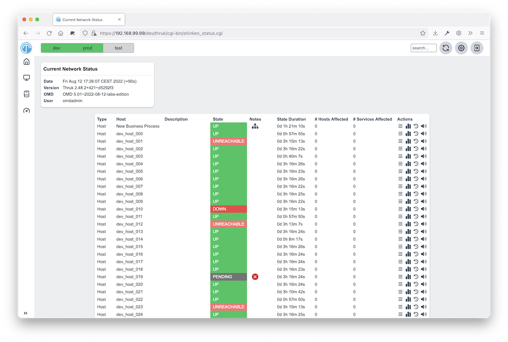](plugins/shinken-business1.png)
<br style="clear: both;">

## Additional Plugins

### Woshsh

```
 Author:      Sven Nierlein
 Description: Generic Text Editor
 Download:    https://github.com/sni/thruk-plugin-woshsh
```

The woshsh plugin allows you to edit xls files, mainly to provide a datasource
for the coshsh configuration generator.

[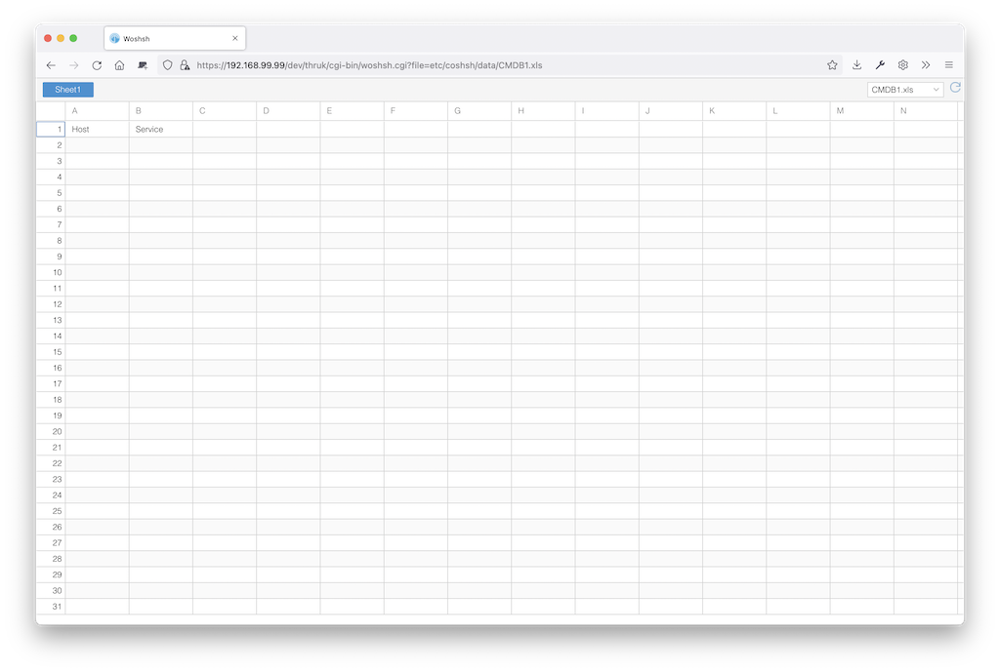](plugins/woshsh1.png)
<br style="clear: both;">

### Pansnaps

```
 Author:      Danijel Tasov
 Description: Generic Text Editor
 Download:    https://github.com/ConSol/thruk-plugin-pansnaps
```

The pansnaps plugin allows you to export panorama dashboards as static images.

[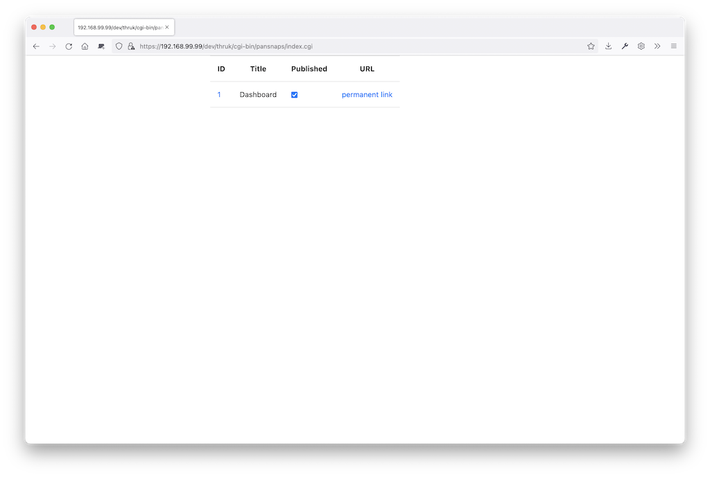](plugins/pansnaps.png)
<br style="clear: both;">

## Installation

1. Unpack the plugin in 'plugins-available'.
2. Create a symlink in 'plugins-enabled' that points to the plugin.
3. If you use mod_fastcgi, restart Thruk. If you use mod_fcgid, restart your webserver.

### Deactivate

1. Remove the symlink from 'plugins-enabled'.
2. If you use mod_fastcgi, restart Thruk. If you use mod_fcgid, restart your webserver.

### Uninstall

Remove the plugin from 'plugins-available'.

Since version 1.36 you may use the Plugin Manager from the 'config
tool' plugin to select your plugins.

[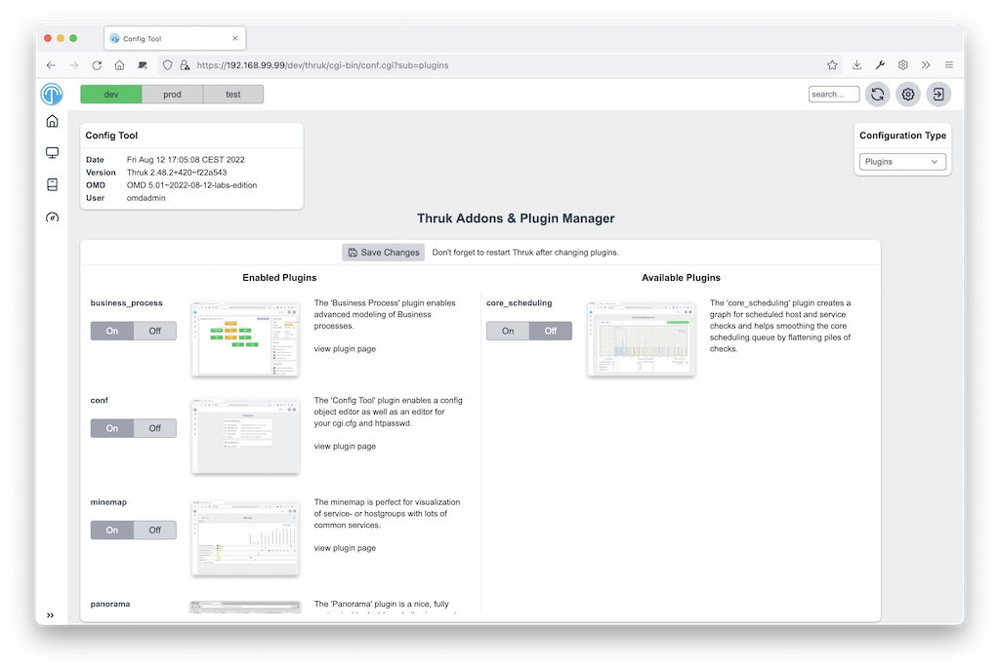](plugins/pluginmanager.png)

### Hello World Plugin

```
 Author:      Mikael Nordin
 Description: Hello World Plugin
 Download:    https://github.com/mickenordin/thruk_hello
```

The hello world plugin should get you started if you want to
write your own plugin.

## Writing your own plugins {#_writing-your-own-plugins}

The plugin directory structure is similar to a Perl module.
This example has lib, static content, templates and tests.
Not every plugin needs all of them.

::: tip
Ask to have your plugin listed here.
:::

```text
  ├── lib
  │   └── Thruk
  │       └── Controller
  ├── root
  │   └── images
  ├── t
  └── templates
```

**Structure**

- 'lib' contains all Perl files
- 'root' contains all static content
- 't' keep the tests here
- 'templates' contains all template files for dynamic pages

### Hello World Plugin
This example creates a plugin that displays "Hello World!" on hello.cgi.

First, create the plugin directory structure. On Linux, use:

```sh
mkdir -p hello/{lib/Thruk/Controller,templates}
```

Create these files:

- hello/description.txt
- hello/preview.png
- hello/routes
- hello/lib/Thruk/Controller/hello.pm
- hello/templates/hello.tt

**hello/description.txt**
This file contains plugin information for the overview page. For example:

```text
The 'Hello World' plugin displays the words "Hello World!" on the
plugin page hello.cgi.

Url: hello.cgi
```

**hello/preview.png**
This is an image file that is also displayed on the plugin overview.

**hello/routes**
This file is a Perl module snippet that defines a sidebar menu item:

```perl
##########################################################

=head2 add_routes

page: /thruk/cgi-bin/hello.cgi

=cut

$routes->{'/thruk/cgi-bin/hello.cgi'} = 'Thruk::Controller::hello::index';

# add new menu item
Thruk::Utils::Menu::insert_item('System', {
                                'href'  => '/thruk/cgi-bin/hello.cgi',
                                'name'  => 'Hello World!',
});
```

**hello/lib/Thruk/Controller/hello.pm**
This Perl module contains the code that runs.
It sets hello_var in Thruk::Context so the template can access it later:

```perl
package Thruk::Controller::hello;

use strict;
use warnings;

=head1 NAME

Thruk::Controller::hello - Hello World!

=head1 DESCRIPTION

Hello World!.

=head1 METHODS

=cut

=head2 index

=cut

sub index {
        my ( $c ) = @_;

        return unless Thruk::Action::AddDefaults::add_defaults($c, Thruk::Constants::ADD_CACHED_DEFAULTS);

        $c->stash->{title}           = 'Hello World!';
        $c->stash->{'subtitle'}              = 'Hello World!';
        $c->stash->{'infoBoxTitle'}          = 'Hello World!';
        $c->stash->{template} = 'hello.tt';
        $c->stash->{hello_var} = 'Hello World!'; # This is our magic variable
}

1;
```

**hello/templates/hello.tt**
This file is the template that builds our HTML for the hello.cgi page. It mostly
consists of HTML with some variables accessed via the [% variable_name %] notation.

```html
<!DOCTYPE html>
<html>
	<head>
		<title>[% title_prefix %][% title %]</title>
		[% PROCESS _favicon.tt %]
		<meta http-equiv="Content-Type" content="text/html; charset=utf-8" />
		<meta name="viewport" content="width=device-width, initial-scale=1, maximum-scale=1, user-scalable=no" />
	</head>
	<body>
		<h1>[% hello_var %]</h1> <!-- This is where we access our variable -->
	</body>
</html>
```

To use Thruk's shared CSS, change the template as follows:

```html
<!DOCTYPE html>
<html>
	<head>
		<title>[% title_prefix %][% title %]</title>
		[% PROCESS _favicon.tt %]
		<meta http-equiv="Content-Type" content="text/html; charset=utf-8" />
		<meta name="viewport" content="width=device-width, initial-scale=1, maximum-scale=1, user-scalable=no" />
		[% PROCESS _common_css.tt  %]
		[% PROCESS _header.tt
			css=["plugins/conf/conf.css"]
			js=["plugins/conf/conf.js"]
		%]
	</head>
	<body>
		<h1>[% hello_var %]</h1> <!-- This is where we access our variable -->
	</body>
</html>
```

You can also add some info boxes and your plugin will look like all the rest:

```html
<!DOCTYPE html>
<html>
	<head>
		<title>[% title_prefix %][% title %]</title>
		[% PROCESS _favicon.tt %]
		<meta http-equiv="Content-Type" content="text/html; charset=utf-8" />
		<meta name="viewport" content="width=device-width, initial-scale=1, maximum-scale=1, user-scalable=no" />
		[% PROCESS _common_css.tt %]
		[% PROCESS _header.tt
			css=["plugins/conf/conf.css"]
			js=["plugins/conf/conf.js"]
		%]
	</head>
	<body>
		[% PROCESS _message.tt %]
		[% PROCESS _overdiv.tt %]
		[% PROCESS _infobox.tt %]
		<h1>[% hello_var %]</h1> <!-- This is where we access our variable -->
	</body>
</html>
```

You can also protect your cgi page using the authorization settings from cgi.cfg.

To limit access, check both 'authorized_for_configuration_information' and
'authorized_for_system_commands' with '$c->check_user_roles'.
Change the index function in 'hello/lib/Thruk/Controller/hello.pm' as shown below.
This prevents access without both permissions:

```perl

sub index {
        my ( $c ) = @_;

        return unless Thruk::Action::AddDefaults::add_defaults($c, Thruk::Constants::ADD_CACHED_DEFAULTS);
        if( !$c->check_user_roles("authorized_for_configuration_information") || !$c->check_user_roles("authorized_for_system_commands")) {
                return $c->detach('/error/index/8');
        }

        $c->stash->{title}           = 'Hello World!';
        $c->stash->{'subtitle'}              = 'Hello World!';
        $c->stash->{'infoBoxTitle'}          = 'Hello World!';
        $c->stash->{template} = 'hello.tt';
        $c->stash->{hello_var} = 'Hello World!'; # This is our magic variable
}

```

Restart the webserver. The Thruk sidebar now has a link to hello.cgi.

[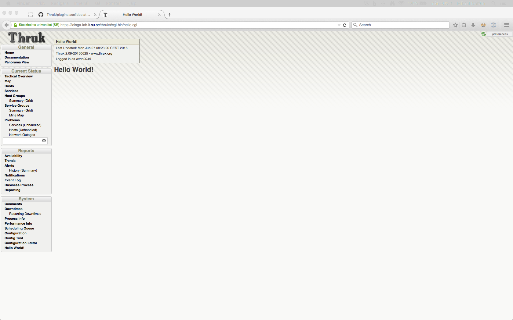](plugins/hello1.png)
<br style="clear: both;">

::: tip
Try to copy an existing plugin, change it to your needs
or copy/paste ideas from it to your own.
:::
