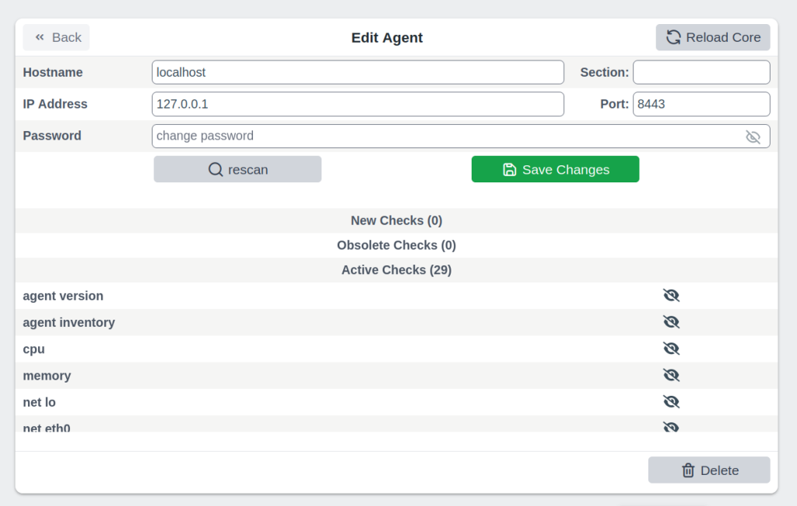

# Agents Thruk Plugin

The agents plugin configures SNClient+ agents in Naemon.
It runs inventory scans on snclient agents and creates host and service checks
with minimal manual work.

[](agents.png)
<br style="clear: both;">

### Installation

These instructions assume you use OMD ([omd.consol.de](https://omd.consol.de)).

Thruk includes this core plugin. To enable it, run `thruk plugins enable agents`
or use the plugins section in the config tool.

Check that `System` -> `Agents` appears in the menu.

### Configuration

Create a configuration file:

`~/etc/thruk/thruk_local.d/agents.conf`.

There is a [example configuration](#_example-configuration) at the end.

### Rules

Use rules to exclude service checks without disabling each one manually.
You can adjust rules for many or all hosts at once.

The plugin applies rules in their configuration file order.

If the plugin supports it, use `<disable>` to select specific checks.
For example, to disable network device checks on localhost, use:

```
    <disable network>
      enabled != true
      name    ~  ^(lo|.*Loopback)
    </disable>
```

This provides a way to exclude services based on inventory values.

To exclude service checks by name, use:

```
    <exclude>
      name = check_services  # name match
      name ~ net lo          # name regex match
    </exclude>
```

#### Testing Rules

Before you apply changed rules to all hosts, test them on the command line.

List all changes:

```
  %> ta -II ALL -n
```

Show all changes for a specific host in detail:

```
  %> ta -II hostname -n -v
```

### Matching Rules

Rule blocks such as `extra_service_opts`, `extra_host_opts` and `extra_service_checks`
support matching patterns for `section`, `tags`, `host` and `service`.

Examples:

#### Match All

```
# default is to match all hosts / services
host    = ANY
service = ANY
section = ANY
tags    = ANY
```

If you use multiple attributes, all must match:

```
# matches all hosts starting with abc but they must also have the tag1 tag.
host = ^abd
tags = tag1
```

#### String Match

```
# simple string compare, exact match (case insensitive)
# matches localhost or Localhost
host = localhost
```

#### Wildcard Match

```
# wildcard match (case insensitive)
# matches localhost
host = local*
```

#### Regexp Match

```
# regular expression match (case insensitive)
# matches localhost or Localhost
host ~ local.*
```

Note: Anchor regular expressions with `^pattern$`.
Otherwise, `tag1` also matches `tag10`.

#### Combined Match

```
# multiple tags (OR)
# matches if host has either tag1 or tag2
tags = tag1, tag2     # as string match
tags ~ ^(tag1|tag2)$  # as regexp
# is the same as
tags = tag1
tags = tag2

# multiple tags (AND)
# matches only if all given tags exist
tags = tag1 && tag2
```

#### Exclude Match

```
# exclude something
# exclude pattern start with a '!'
# this matches all hosts except localhost
host = ANY
host = !localhost
```

```
# this matches all hosts which have tag1 but must not have tag2
tags = tag1 && !tag2
```

### Process Checks

The `<proc>` block defines process checks.
The basic variant matches the process name. The advanced variant matches the full command line.

The plugin creates no specific process checks by default.
Define the processes to check.

#### Basic

This example will create a service check for all processes named `snclient` or `httpd`.

```
<proc>
  name = snclient
  name = httpd
  user = ANY
</proc>
```

The `name` expression is applied on the process executable name.

#### Advanced

The advanced variant matches the process's full command line.
You can also set the service name.

```
<proc>
  # service name (available placeholder: %u - user | %e - executable)
  name     = ssh controlmaster %u
  match    ~ /usr/bin/ssh.*ControlMaster=yes
  user     = ANY
  #host    = ANY     # restrict to specific hosts
  #section ~ test # apply this process check only to sections containing "test"
  #warn    = 1:5  # warning threshold for number of processes (low:high)
  #crit    = 1:10 # critical threshold
</proc>
```

The `match` expression matches a substring of the full command line.

### Services Checks

The `<service>` block defines checks for Windows or Linux services.

The plugin creates no specific service checks by default.
Define the services to check.

#### Basic Service Check

```
<service>
  # service name (available placeholder: %s - service name)
  name     = service %s
  service  = apache2   # service name exact match
  service  ~ winlogon  # match all services containing 'winlogon'

  #host    = ANY  # restrict to specific hosts
  #section ~ test # apply this service only to sections containing "test"
  #tags    = prod # apply this service only to hosts with tag "prod"
</service>
```

With wildcards or regular expressions, the example above creates service checks
for each matching service.

#### Combine Multiple Services In One Check

If you want to create a single check for multiple services, use the `all_in_one` attribute:

```
<service>
  name       = all custom services
  service    ~ ^custom
  all_in_one = 1

  #host    = ANY  # restrict to specific hosts
  #section ~ test # apply this service only to sections containing "test"
  #tags    = prod # apply this service only to hosts with tag "prod"
</service>
```

### Tips & Tricks

#### Add Additional Service Checks

Use rules to add service checks that the inventory does not create.

For example, add a ping check to all hosts.

```
    <extra_service_checks>
      host    = ANY
      section = ANY
      tags    = ANY

      name    = ping  # the actual service description
      # add arbitrary naemon config attributes here as well
      check_command            = check-host-alive!$HOSTADDRESS$
      use                      = srv-perf,generic-service
      first_notification_delay = 30
    </extra_service_checks>
```

#### Adjust Host / Service Attributes

Use `extra_service_opts` or `extra_host_opts` to adjust host/service object attributes programmatically.

Here are a few examples:

**set / overwrite attributes**

```
    <extra_service_opts>
      # match all services named 'cpu'
      service  = cpu

      # set/overwrite contacts and timeperiod to a new value
      contacts            = admin
      notification_period = office_hours
    </extra_service_opts>
```

**append to list attributes**

```
    <extra_service_opts>
      # set all contacts to this one
      contacts = admin
    </extra_service_opts>

    # extend special services
    <extra_service_opts>
      # match all services named 'memory'
      service  = memory

      # extend list of contacts
      contacts = +manager
    </extra_service_opts>
```

**remove from list attributes**

```
    <extra_service_opts>
      # first set all contacts to these
      contacts = admin, manager, customer
    </extra_service_opts>

    # extend special services
    <extra_service_opts>
      # match all services named 'memory'
      service  = memory

      # remove from list of contacts
      contacts = !manager
      contacts = !customer
    </extra_service_opts>
```

#### Always OK Inventory Check

If the inventory check should always return OK, use `--always-ok`.
This can help when you use the check in dashboards.

Apply this option to all inventory checks:

```
    <extra_service_opts>
      service = agent inventory
      args    = --always-ok
    </extra_service_opts>
```

### Example Configuration {#_example-configuration}

```
<Component Thruk::Agents>
  <snclient>
    # use a default backend if there are multiple
    default_backend = LOCAL

    # set a default password macro, ex.: $USER5$
    default_password = $USER5$

    # add extra options to check_nsc_web
    check_nsc_web_extra_options = "-k -t 35"

    # change default port used to build the check command
    default_port = 8443

    # override check interval
    check_interval = 1
    retry_interval = 0.5
    max_check_attempts = 3

    # override inventory interval
    inventory_interval = 60

    # override os updates interval
    os_updates_interval = 60

    # set default contact(s)
    #default_contacts = admin, other

    # set default contactgroups(s)
    #default_contactgroups = group, ...

    # set performance data templates (default is autodetect based
    # on whether grafana is enabled)
    #perf_template      = srv-perf
    #host_perf_template = host-perf

    # set default options for specific check types
    <default_opt>
      drivesize = show-all freespace-ignore-reserved=false
    </default_opt>

    # disable network checks matching these attributes
    <disable network>
      enabled != true
      name    ~ ^(lo|.*Loopback)
      flags   ~ loopback
    </disable>

    # disable check_drivesize checks matching these attributes
    <disable drivesize>
      fstype  ~ ^(tracefs|securityfs|debugfs|configfs|pstorefs|fusectl|cgroup2fs|bpf|efivarfs|sysfs|fuseblk|rpc_pipefs|nsfs|ramfs|binfmt_misc|proc|nfs|devpts|mqueue|hugetlbfs)$
      drive   ~ ^(/run/|/dev|/boot/efi|/proc|/sys)
      mounted = 0
      drive   =
    </disable>

    # disable services by name or type
    <exclude>
      #name = check_users   # name string match
      #name ~ net lo        # name regex match
      #type = df./proc      # type string match
      #type ~ ^extscript\.  # type regex, disable all external scripts by default
      #host !~ \.win\.      # apply this exclude only to specific hosts, only hosts not matching ".win."
      #host ~ ^l            # apply this exclude only to hosts starting with an "l"
      #section ~ test       # apply this exclude only to sections containing "test"
      #tags = prod          # apply this exclude only to tag "prod"
    </exclude>

    # include services in discovery
    <service>
      # service name (available placeholder: %s - service name)
      name     = service %s
      service  = snclient
      service  = apache2
      service  = postfix
      service  = ssh
      service  = exim4
      service  = mariadb
      service  = ntp
      service  = squid
      service  ~ ^custom  # all services starting with custom will be created as separate checks

      #host    = ANY  # restrict to specific hosts
      #section ~ test # apply this service only to sections containing "test"
      #tags    = prod # apply this service only to hosts with tag "prod"
    </service>

    # add a service check for multiple services in one check
    <service>
      name       = all custom services
      service    ~ ^custom
      all_in_one = 1

      #host    = ANY  # restrict to specific hosts
      #section ~ test # apply this service only to sections containing "test"
      #tags    = prod # apply this service only to hosts with tag "prod"
    </service>

    <proc>
      # service description (available placeholder: %u - user | %e - executable)
      name     = ssh controlmaster %u
      match    ~ /usr/bin/ssh.*ControlMaster=yes
      user     = mon
      #host    = ANY     # restrict to specific hosts
      #section ~ test # apply this process check only to sections containing "test"
      #warn    = 1:5  # warning threshold for number of processes (low:high)
      #crit    = 1:10 # critical threshold
    </proc>

    <proc>
      # if no match is given, use the name as exe filter
      name  = snclient
      name  = httpd
    </proc>

    # set generic process threshold
    <extra_service_opts>
      service = ^processes$
      args    = warn='count > 2000' crit='count > 2000'
    </extra_service_opts>

    # set zombie process threshold
    <extra_service_opts>
      service = ^zombie processes$
      args    = warn='count > 0' crit='count > 5'
    </extra_service_opts>

    # set extra service attributes (if multiple blocks match, each is applied in order and overwrites previous values)
    # block can be used multiple times
    <extra_service_opts>
      service  ~ ^cpu$ # regex match on service description
      #host    = ANY # restrict to specific hosts
      #section ~ test # apply this attributes only to sections containing "test"
      tags     = ANY

      # can be used to append extra arguments to the command line
      #args = warn='load > 95' crit='load > 100'

      # naemon service attributes will be added to the generated host configuration
      first_notification_delay = 30
      notification_options     = w,c
      # other naemon service attributes...
    </extra_service_opts>

    # set extra host attributes (if multiple blocks match, each is applied in order)
    # block can be used multiple times
    <extra_host_opts>
      host     = ^hostname$ # regex match on host name
      #section ~ test # apply this attributes only to sections containing "test"
      tags     = ANY

      # naemon host attributes will be added to the generated host configuration
      #first_notification_delay = 30
      #check_command = check-host-alive!$HOSTADDRESS$
      # other naemon host attributes...
    </extra_host_opts>

    # add custom snclient based service checks
    <extra_service_checks>
      # on which host / sections / tags should this serice be created
      host    = ANY
      section = ANY
      tags    = ANY

      name    = dns           # the actual service description
      check   = check_dns     # snclient check
      args    = -H thruk.org  # check arguments
      # add arbitrary naemon config attributes here as well
      use                      = srv-perf,generic-service
      first_notification_delay = 30
    </extra_service_checks>

    # add custom service checks
    <extra_service_checks>
      # on which host / sections / tags should this serice be created
      host    = ANY
      section = ANY
      tags    = ANY

      name    = ping  # the actual service description
      check_command = check-host-alive!$HOSTADDRESS$
      # add arbitrary naemon config attributes here as well
      use                      = srv-perf,generic-service
      first_notification_delay = 30
    </extra_service_checks>
  </snclient>
</Component>
```
