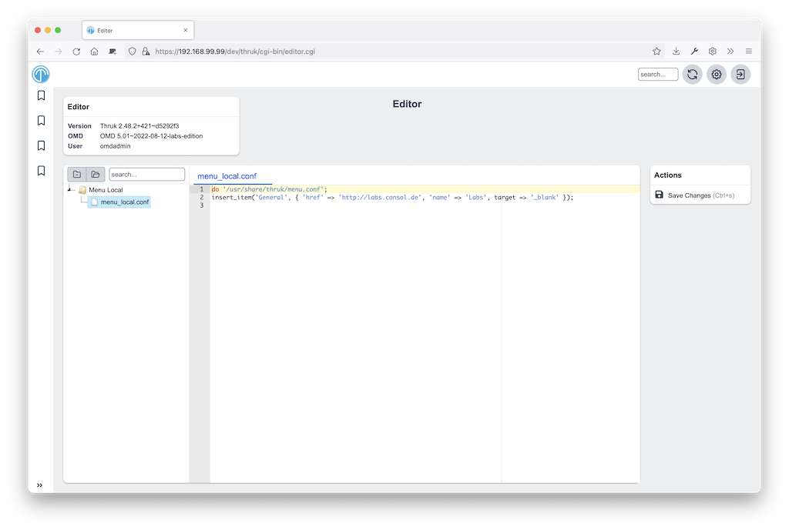

# Editor Thruk Plugin

This plugin allows you to edit text files.

[](editor.png)
<br style="clear: both;">

### Installation

These instructions assume you use OMD ([omd.consol.de](https://omd.consol.de)).

Thruk includes this core plugin. To enable it, run `thruk plugins enable editor`
or use the plugins section in the config tool.

Check that `System` -> `Editor` appears in the menu.

### Configuration

Define which text files users can edit. Create this file:

`~/etc/thruk/thruk_local.d/editor.conf`.

For example:

```
<editor>
  name   = Menu Local
  groups = Admins,Superadmins

  <files>
    folder = etc/thruk/
    filter = menu_local\.conf$
    syntax = perl
    action = perl_editor_menu

    # hooks which will be executed before or after saving a single file.
    #pre_save_cmd        =
    #post_save_cmd       = ./examples/config_tool_git_checkin
    #show_summary_prompt = 1   # enable/disable summary prompt if hooks are set
  </files>
</editor>

<action_menu_actions>
  perlsyntax   = /usr/bin/perl -Mstrict -wc
</action_menu_actions>
```

Reload Apache to activate changes from `thruk_local.d`.

### Authorization

To control access, use `groups` as shown above or put editor sections in a Group block:

```
<Group Admins>
  <editor>
    name   = Business Process
    <files>
      folder = /etc/thruk/bp/
      filter = \.pm$
      syntax = perl
    </files>
  </editor>
</Group>
```

### Syntax Highlighting

Available syntax highlighting modes are listed as mode-* files in
https://github.com/sni/thruk/tree/master/root/thruk/vendor/ace-builds-1.4.12/src-min-noconflict

Common syntax modes are:

- sh
- perl
- python
- ini
- naemon
- nagios

### Actions

To add a syntax check action, create this file:

`~/etc/thruk/action_menus/perl_editor_menu.json`.

With this content:

```
[
  "-",
  {"icon":"fa-spell-check",
    "label":"Syntax Check",
    "action":"server://perlsyntax/$TMPFILENAME$"
  },
]
```

### Action Scripts / Hooks

Action scripts can perform any task, such as syntax checks or activating changes.
Thruk displays their output in a popup. Exit code `0` makes the popup green.
Any other exit code makes it red.

A `pre_save_cmd` script exiting other than 0 will cancel the current save attempt.

#### Macros

The editor plugin provides some extra macros.

- `$FILENAME$` contains the path to the open (unsaved) file.
- `$TMPFILENAME$` contains the path to a temporary file with the
  current (unsaved) content changes. Use this macro for syntax checks or similar.

#### Environment

The editor plugin sets extra environment variables for pre/post hook scripts.
Use them, for example, to create git commits automatically.

- `$THRUK_EDITOR_FILENAME` same as `$FILENAME$` in macros.
- `$THRUK_EDITOR_TMPFILENAME` same as `$TMPFILENAME$` in macros (only available in pre script).
- `$THRUK_EDITOR_STAGE` can be either 'pre' or 'post'.
- `$THRUK_SUMMARY_MESSAGE` set from user input (popup on save).
- `$THRUK_SUMMARY_DETAILS` set from user input (popup on save).
