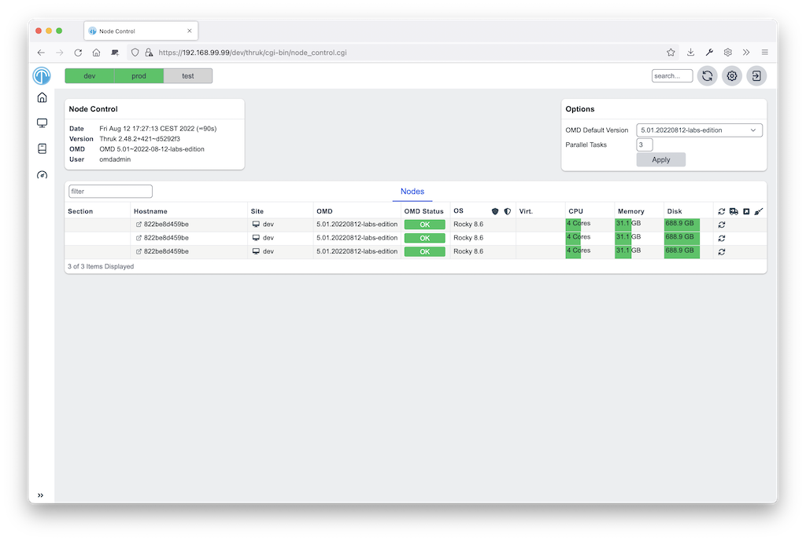

# Node Control Thruk Plugin

This plugin allows you to control nodes (OMD / OS) from within Thruk.

[](node-control.png)
<br style="clear: both;">

### Features

- OMD installation
- OMD site updates
- OMD cleanup old unused versions
- OMD services start/stop
- OS Updates

### Installation

This plugin requires OMD ([omd.consol.de](https://omd.consol.de)).

Thruk includes this core plugin. To enable it, run `thruk plugins enable node-control`
or use the plugins section in the config tool.

Check that `System` -> `Node Control` appears in the menu.

### Setup

You can give controlled sites sudo permissions for omd and their package manager.

- Debian: `siteuser  ALL=(ALL) NOPASSWD: /usr/bin/omd, NOPASSWD:SETENV: /usr/bin/apt-get`
- Centos: `siteuser  ALL=(ALL) NOPASSWD: /usr/bin/omd, NOPASSWD: /usr/bin/dnf`

(replace siteuser with the actual site user name)

Optional SSH access lets you start services when HTTP is unavailable, for example
when the site is stopped.

Without sudo permissions you can only update to existing omd versions.

### Configuration

thruk_local.conf:

```
<Component Thruk::Plugin::NodeControl>
  # command will be run on the local node (the one starting the update) prior the update. Exit code != 0 will abort the update
  #hook_update_pre_local  =

  # command will be run on the remote node (the one which will be updated) prior the update. Exit code != 0 will abort the update
  # use special syntax with script: prefix to upload local script, ex.: script:local/script.sh
  #hook_update_pre  = if [ $(git status --porcelain 2>&1 | wc -l) -gt 0 ]; then echo "omd home not clean"; git status --porcelain 2>&1; exit 1; fi

  # command will be run on the remote node (the one which will be updated) after the update
  #hook_update_post = git add . && git commit -a -m "update to omd $(omd version -b)"

  # command will be run on the local node (the one starting the update) after the update.
  #hook_update_post_local  =

  # set to 0 to disable ssh fallback in case http connection fails
  #ssh_fallback = 1

  # ssh base options in case of ssh fallback connection
  ssh_base_options = -o BatchMode=yes -o LogLevel=INFO -n -T

  # ssh additional options
  ssh_options =

  # ssh base options in case of ssh fallback connection
  scp_base_options = -B

  # ssh base options in case of ssh fallback connection
  scp_options =

  # set to 0 to disable os updates, set it to 2 to show updates but dont offer updating them
  #os_updates = 1

  # set to 0 to disable pkg installation
  #pkg_install = 1

  # set to 0 to disable pkg update
  #pkg_update = 1

  # set to 0 to disable pkg cleanup
  #pkg_cleanup = 1

  # set to 0 to hide 'all' buttons
  #all_button = 1

  # number of parallel task when running actions for all hosts
  #parallel_tasks = 3

  # set to 1 to not require confirm on all actions
  #skip_confirms = 0

  # exclude sites (by name or id) from node-control (comma separated regular expressions)
  #excludes = site1,site2

  # command used to cleanup unused omd versions
  #cmd_omd_cleanup       = sudo -n omd cleanup

  # script used to do the omd update
  #omd_update_script     = scripts/omd_update.sh

  cmd_yum_pkg_install   = sudo -n yum install -y %PKG
  cmd_dnf_pkg_install   = sudo -n dnf install -y %PKG
  cmd_apt_pkg_install   = DEBIAN_FRONTEND=noninteractive sudo -En apt-get install -y %PKG

  cmd_yum_os_update     = sudo -n yum upgrade -y
  cmd_dnf_os_update     = sudo -n dnf upgrade -y
  cmd_apt_os_update     = DEBIAN_FRONTEND=noninteractive sudo -En apt-get upgrade -y

  cmd_yum_os_sec_update = sudo -n yum upgrade -y --security
  cmd_dnf_os_sec_update = sudo -n dnf upgrade -y --security
  cmd_apt_os_sec_update = DEBIAN_FRONTEND=noninteractive sudo -En apt-get upgrade -y
</Component>
```

Configure hooks to commit version updates to git automatically.
This requires git and an OMD site stored in a git repository.

### Hooks

Hooks run in this order:

- `hook_update_pre_local`: runs on the local node before the update.
- `hook_update_pre`: runs on the remote node before the update.
- `hook_update_post`: runs on the remote node after the update.
- `hook_update_post_local`: runs on the local node after the update.

The pre hooks can abort the update process by exiting != 0.

All hooks can use these environment variables:

- `PEER_NAME`:        name of the backend as set in the thruk.conf.
- `PEER_KEY`:         internal id of the backend.
- `OMD_HOST_NAME`:    remote host name of this backend.
- `SITE_NAME`:        site name which will be updated.
- `FROM_OMD_VERSION`: current omd version that site is running.
- `OMD_UPDATE`:       omd version that'll be used for the update.

If a hook prints `[ERROR]` or `[WARNING]` messages, the logfile will be
highlighted. This can be used to indicate non-fatal issues.

### Additional Backends

You can add backends to node-control without showing them on normal status pages.

Add `tags  = node-control` to the backend configuration.
The backend then appears only on the node control page, not on normal status pages.

For example if the backend is available by ssh only:

thruk_local.conf:

```
<Component Thruk::Backend>
   <peer>
      name  = ssh only
      type  = configonly
      tags  = node-control
      <options>
          host_name = some_ssh_hostname.local
          site_name = omd_site_user
      </options>
    </peer>
</Component>
```

And if it's a OMD site available by http:

```
<Component Thruk::Backend>
    <peer>
      name  = http backend
      type  = http
      tags  = node-control
      <options>
          peer = https://http_site.local/sitename/
          auth = http auth key
      </options>
    </peer>
</Component>
```
