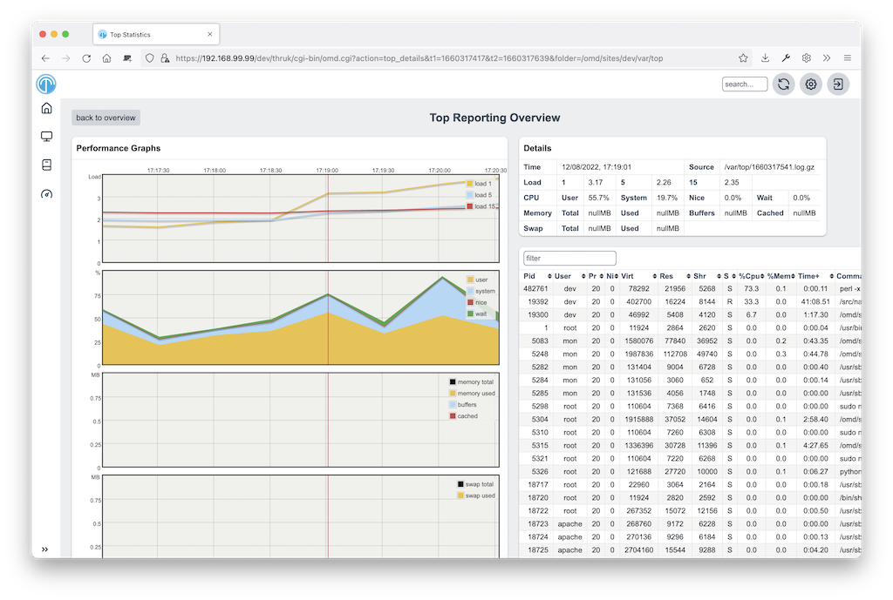

# OMD Top Thruk Plugin

This plugin saves top data every minute and draws graphs to help investigate
performance problems on the monitoring host.



## Installation

These instructions assume you use OMD ([omd.consol.de](https://omd.consol.de)).

Thruk includes this core plugin. To enable it, run `thruk plugins enable omd`
or use the plugins section in the config tool.

Check that `System` -> `OMD Top` appears in the menu.

### Configuration

Define process groups in one of these files:

`~/etc/thruk/thruk_local.d/omd_top.conf

or

`~/etc/thruk/thruk_local.conf`

For example:

```
omd_top = squid                   = squid
omd_top = /sbin/httpd2            = apache2
omd_top = /usr/sbin/mysqld        = mysql
omd_top = /bin/mod_gearman_worker = mod-gearman
```

Define no more than 10 groups so they fit on the graph.
Reload Apache to activate changes.

## Usage

The cronjob collects top data for the last 3 days.
On the start page, select a time range to examine.

On the second page, select data points to fetch detailed top data.
Click a table header to sort the data.

## Extending by own Parsers

The default parser reads Linux top data.
To write a custom parser, add an input source to `thruk_local.conf`:

```
omd_top_extra_dir = WinCPU=var/cputop
```

Then implement a parser, such as OMD/Top/Parser/WinCPU.pm, based on LinuxTop.pm.
