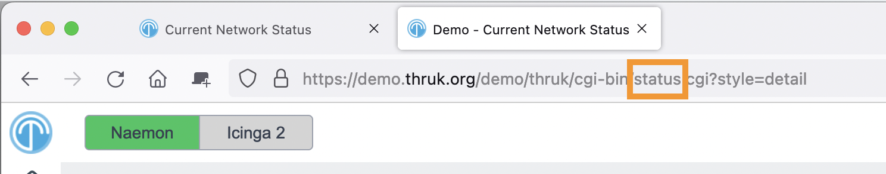

# Server Side Includes

Place static include files or executables in the ssi folder.
Thruk inserts static files just after the opening body tag or just before the closing body tag.

::: info Important
Thruk implements its own SSIs independently of the Apache module `mod_include`.
:::

### Common Includes

Thruk inserts global includes in every cgi page:

- pass:[ssi/common-footer.ssi]
- pass:[ssi/common-footer-*.ssi]
- pass:[ssi/common-header.ssi]
- pass:[ssi/common-header-*.ssi]

### Page Specific Includes

Thruk inserts page-specific includes only in the matching page:

- pass:[ssi/&lt;page&gt;-footer.ssi]
- pass:[ssi/&lt;page&gt;-footer-*.ssi]
- pass:[ssi/&lt;page&gt;-header.ssi]
- pass:[ssi/&lt;page&gt;-header-*.ssi]

Replace &lt;page&gt; with the page name from the URL (see screenshot).
Includes work only for cgi pages. Static HTML pages such as index.html do not support them.

+++
[](ssi_page.png)
+++

### Static and Dynamic Includes

Thruk inserts static files into the cgi output.
For executables, Thruk runs the file and inserts its output as content.

### Template Toolkit Syntax

<Badge type="tip" text="New in Thruk 2.34" />
Starting with Thruk 2.34 you can use [Template Toolkit syntax](http://template-toolkit.org/docs/manual/Syntax.html) in your SSI files.

### Examples

To change the login logo and add help text, create an ssi file as shown below.
Store company.png in your `usercontent/images` folder.

**login-header.ssi:**

```
<script language="javascript" type="text/javascript">
<!--
  var note = "<span style='color: #EE6E00; font-size: 25px;'>Test Server</span>";
  jQuery(document).ready(function() {
    jQuery("DIV.loginmask IMG")
      .attr('src', '../usercontent/images/company.png')
      .attr('width', '50%')
      .attr('height', '50%');
    jQuery("DIV.loginmask A").first().after("<br><b><div align='center'>"+note+"</div></b>");
  });
-->
</script>
```

If the user is not in the Admins contact group, hide images in the extinfo page's plugin output:

**extinfo-header.ssi:**

```
[% IF !c.user_exists || !c.user.has_group("Admins") %]
<script>
jQuery(document).ready(function() {
    jQuery("TD.detail_plugin_output IMG").hide().after("<div>Image removed</div>");
});
</script>
[% END %]
```

Show an alert box on all pages:

**common-header.ssi:**

```
<div class="alert floating" style="position: absolute; left: 0; right: 0; margin-left: auto; margin-right: auto; z-index: 100; top: 7px; width: 600px; text-align: center;">
  This alert will be visible on pages.
</div>
```

Style the custom variables box:

**common-header.ssi:**

```
<style>
.cust_var {
    font-style: normal;
    font-size:13px;
    line-height:11px;
}
.cust_var td:first-child {
    text-transform: lowercase;
    font-weight: 600;
    color: var(--text-th) !important;
}
.cust_var td:first-child::first-letter {
    text-transform: uppercase;
}
.cust_var:first-child td {
    padding-top:8px;
}
.cust_var:last-child td {
    padding-bottom:4px;
}
</style>
```
