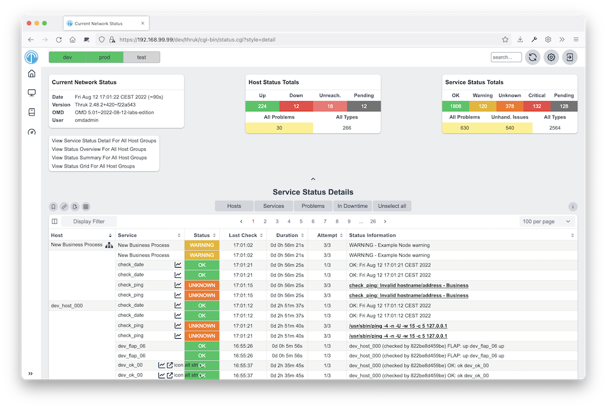
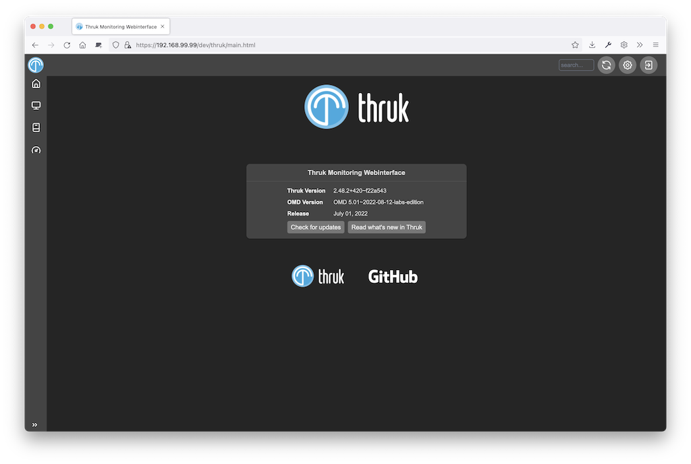
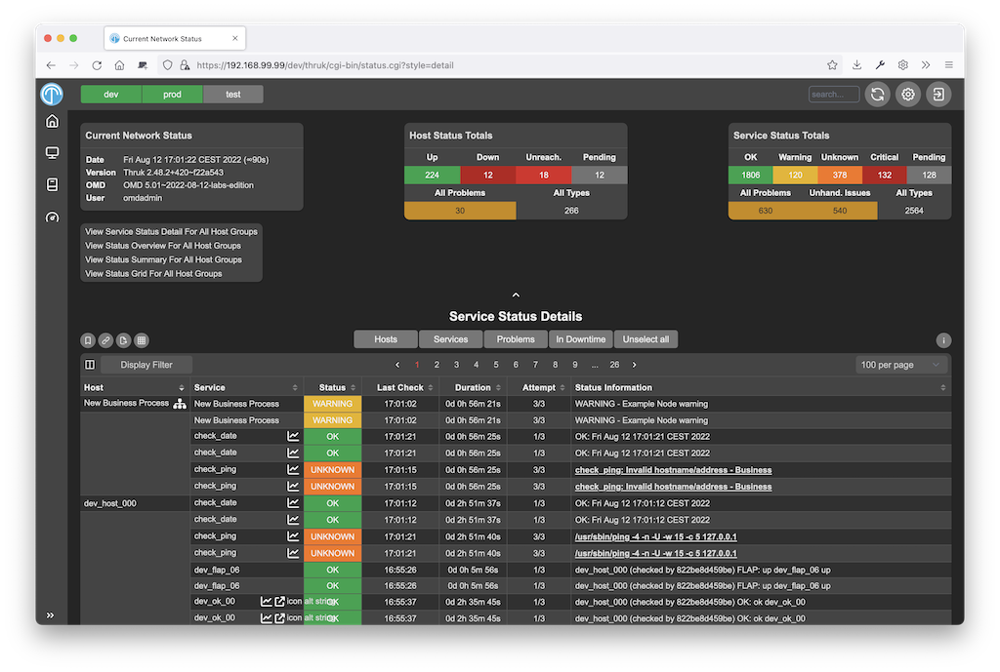

# Themes

Themes change Thruk's appearance. Thruk includes several themes.
Themes normally reside in 'themes/themes-available'.
To activate a theme, create a symlink in 'themes/themes-enabled'.

For packaged installations, the themes folder is directly in the Thruk folder.
For OMD, it is in $OMD_ROOT/etc/thruk/themes.

Example theme structure:

```
  theme/
  ├── images
  └── stylesheets
```

## Installation

1. Unpack the theme in 'themes-available'.
2. Create a symlink in 'themes-enabled' that points to the theme.
3. If you use mod_fastcgi, restart Thruk. If you use mod_fcgid, restart your webserver.

### Deactivate

1. Remove the symlink from 'themes-enabled'.
2. If you use mod_fastcgi, restart Thruk. If you use mod_fcgid, restart your webserver.

### Uninstall

Remove the theme from 'themes-available'.

## Builtin Themes

### Light

```
 Author:      Thruk Team
 Download:    This plugin is builtin and shipped with Thruk
```

[](themes/light1.png)
[](themes/light2.png)
<br style="clear: both;">

### Dark

```
 Author:      Thruk Team
 Download:    This plugin is builtin and shipped with Thruk
```

[](themes/dark1.png)
[](themes/dark2.png)
<br style="clear: both;">

## Write your own themes

A theme has a few folders. Not every theme needs all of them.

```
  MyTheme/
  ├── images
  └── stylesheets
```

**Structure**

- 'images' contains all images needed by this theme. Make sure you
  have at least the basic images.
- 'stylesheets' contain your css files.

::: tip
For a custom theme template and example, see https://github.com/sni/thruk-custom-themes-example
:::

Ask to have your theme listed here.
