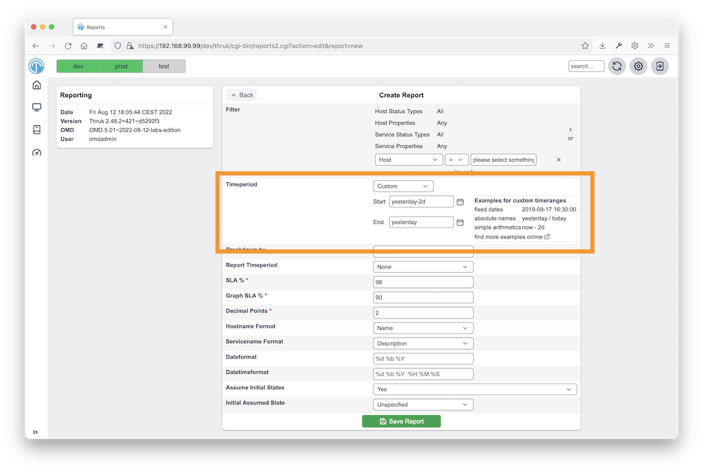

# Time Definitions

<Badge type="tip" text="New in Thruk 2.32" />
Thruk supports several ways to enter a time definition.

[](advanced/timedefinition.png)
<br style="clear: both;">

### Fixed Ranges

You can usually choose a predefined range, such as `last week`.

### Time Arithmetics

If the predefined ranges do not fit, choose `custom`.
Use time arithmetic such as `today - 2d`, which means 2 days before today.

Available terms:

```
 ** `now`            Current time.
 ** `today`          Refers to today at 00:00.
 ** `yesterday`      Yesterday at 00:00.
 ** `lastmonday`     Last Monday at 00:00.
 ** `thisweek`       Monday of current week at 00:00. Same as `lastmonday`
 ** `lastweek`       Monday of last week at 00:00.
 ** `nextweek`       Monday of next week at 00:00.
 ** `thismonth`      First day of current month at 00:00.
 ** `lastmonth`      First day of last month at 00:00.
 ** `nextmonth`      First day of next month at 00:00.
 ** `thisyear`       First day of current year at 00:00.
 ** `lastyear`       First day of previous year at 00:00.
 ** `nextyear`       First day of next year at 00:00.
```

You can use simple calculations:

Tuesday 00:00 of current week: `lastmonday + 86400`

Use these suffixes to make times easier to read:

- `y`: years
- `w`: weeks
- `d`: days
- `h`: hours
- `m`: minutes

You can also write the example above as: `lastmonday + 1d`

::: warning
These calculations do not adjust for timezones or daylight saving time.
:::
