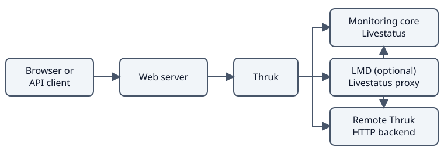

# Architecture

Thruk is a web interface for monitoring cores. It reads their live data through Livestatus or another Thruk installation.
The monitoring core continues to run checks and process monitoring commands.

## Request flow

1. A browser or API client sends a request to the web server.
2. The deployment identifies the user through its configured authentication method.
3. Thruk checks the user's permissions and queries the required backends.
4. Thruk renders a page or returns API data.

Thruk uses Perl and Plack. Production deployments use a web server with a FastCGI or PSGI application setup.
The development server is for local development, not production authentication.

See [web server integration](../documentation/install-webserver.md) and [Nginx setup](../documentation/ubuntu-nginx.md).

## Backend connections

| Connection | Purpose |
| --- | --- |
| Local Livestatus socket | Read live data from a monitoring core on the same host. |
| Remote Livestatus with TLS | Read core data over an encrypted connection. |
| HTTP backend | Connect to another Thruk installation for data and supported remote management. |
| LMD proxy | Combine Livestatus data and manage connections to multiple backends. |

LMD is optional. It can improve performance and connection handling when Thruk connects to many remote sites.
LMD can proxy both Livestatus connections and remote Thruk HTTP backends.
An HTTP backend requires credentials from the remote Thruk installation.
Use HTTPS for remote HTTP connections.

See [backend configuration](../documentation/install.md#backend-configuration) and [LMD](../documentation/lmd.md).

## Configuration and state

Thruk reads shipped defaults and local overrides. Put installation-specific settings in `thruk_local.conf` or `thruk_local.d/`.

- `etc_path` identifies the configuration directory.
- `var_path` identifies persistent application state, including credential and session files.
- `tmp_path` identifies temporary files.

Reports, dashboards and scheduled tasks need persistent state in addition to the monitoring core's data.
A logfile cache stores historical log data separately to speed up queries and reports.

See [configuration](../documentation/configuration.md), [logfile cache](../documentation/logfile-cache.md) and [backup planning](operations.md).

## Background work

Thruk uses background jobs and cronjobs for tasks such as reports and recurring downtimes.
Business process calculations can submit derived results to the monitoring core.
These tasks need the relevant file, backend and operating-system permissions.

Check the [CLI](../documentation/cli.md), [reporting](../documentation/reporting.md) and [business process](../documentation/business-process.md) guides before enabling them.

## Multiple Thruk nodes

A Thruk cluster places a load balancer in front of multiple application nodes.
Nodes share configuration and persistent state. Temporary files stay local.
The cluster coordinates cronjobs so that scheduled work does not run on every node.

A Thruk cluster and a monitoring-core cluster solve different problems.
Adding Thruk nodes does not configure high availability for the monitoring core.

See [cluster setup](../documentation/cluster.md) for shared storage and heartbeat checks.
